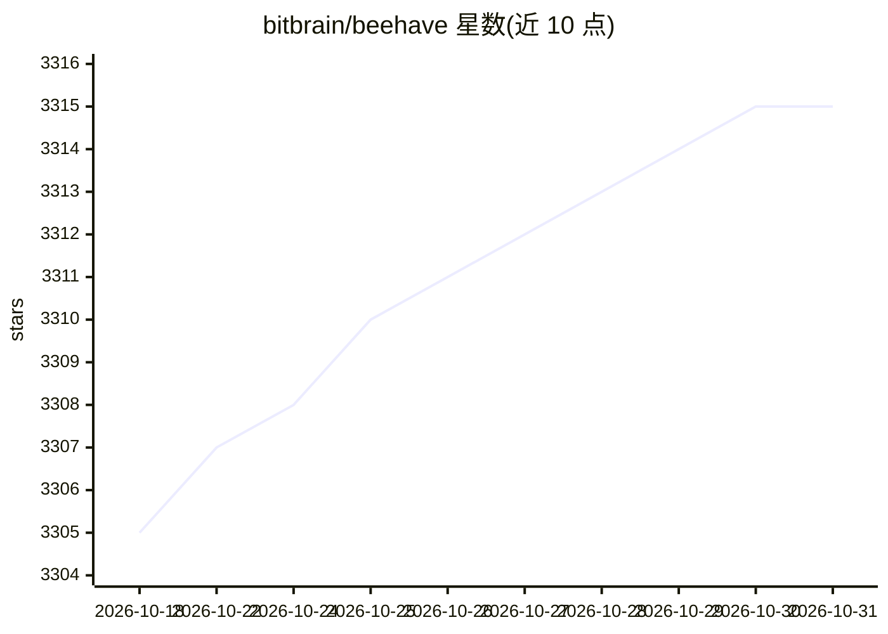

# bitbrain/beehave

⭐ 3,315 · GDScript · MIT · 推送 2026-09-20 · [GitHub](https://github.com/bitbrain/beehave) · [官网](https://bitbra.in/beehave) · 个人维护

**Godot 引擎的行为树 AI 插件：用节点搭建游戏 NPC 行为逻辑**

Godot Engine 的插件（addon），在场景树中以节点方式构建行为树，用于设计 NPC 行为、Boss 战斗等游戏 AI 逻辑。提供编辑器内的行为树调试视图、性能监视器，功能均有单元测试覆盖。安装方式为下载 Release 包并解压到项目 addons 目录后在插件设置中启用；以分支对应 Godot 3.x（Beehave 1.x）与 4.x（Beehave 2.x）版本。附带官方 wiki 与多个第三方教程。

## 筛选速览

| 维度 | 判定 | 备注 |
|---|---|---|
| AI 角色 | `ai-ecosystem` | LLM/agent 周边工具 |
| 许可风险 | `permissive` | MIT |
| 部署形态 | `None` |  |
| 模型依赖 | — | README 未给出锁定关系 |
| 硬件要求 | — | 无带数字的原话,不猜 |
| 安装摩擦 | `low` | 无编译、无系统依赖或容器化 |
| 成熟度 | — | 结构信号不足 |

## 能力要点

- 基于节点在场景树中组合行为树，可挂载到任意节点
- Godot 编辑器内的专用调试视图，运行时分析行为
- 内置性能监视器追踪行为树性能
- 所有功能由单元测试覆盖

## 适用场景

- 为游戏 NPC 设计复杂且可复用的行为逻辑
- 在 Godot 编辑器中调试和监控行为树运行状态
- 搭建 Boss 战斗等需要状态响应的 AI 设定

## 场景标签

 · 领域:游戏开发

## 证据(README 行号)

> L5: **Beehave is a powerful addon for Godot Engine that enables you to create robust AI systems using behavior trees.** 
> L11: ### 🤖 Node based - build behavior trees within your scene tree

## 星数曲线

2026-10-18 3,305 → 2026-10-31 3,315（+10）

---
*卡片 v1 · prompt 1.4 · 生成 2026-10-20 · 置信度 high · 依据 README sha `dcce83434c77` · [字段定义](../../DATASET.md)*
