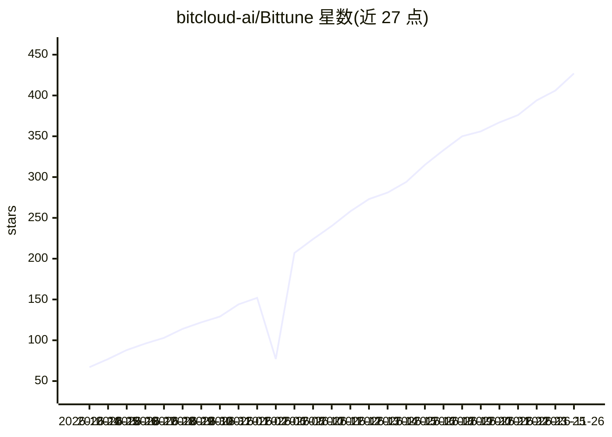

# bitcloud-ai/Bittune

⭐ 427 · TypeScript · MIT · 推送 2026-11-20 · [GitHub](https://github.com/bitcloud-ai/Bittune) · 组织维护 · 中文 README

**在你自己的 GPU 上部署、压测、调优 vLLM/SGLang 的本地 Agent**

Bittune 是运行在用户自有 GPU 机器上的本地推理服务 Harness：Agent 使用 4 个通用工具与 10 个受管工具完成环境探测、部署计划（校验并冻结为不可变快照）、受管容器部署、基于 EvalScope 的规范化压测（TTFT/TPOT/RPS/TPS 等指标）、结果可比性校验与报告生成。所有数字绑定硬件快照与 workload hash，Run、Artifact 与报告存于本地 SQLite+文件，由 Python Core 唯一写入。启动需任意 OpenAI-compatible Agent LLM endpoint；GPU、Docker、NVIDIA Container Toolkit、vLLM/SGLang 为按需准备项。以 Linux x86_64 发行包安装，也可从源码运行。

## 筛选速览

| 维度 | 判定 | 备注 |
|---|---|---|
| AI 角色 | `ai-ecosystem` | LLM/agent 周边工具 |
| 许可风险 | `permissive` | MIT |
| 部署形态 | `library` | 以包/库形式分发 |
| 模型依赖 | local-ok | 支持本地模型 |
| 硬件要求 | — | 无带数字的原话,不猜 |
| 安装摩擦 | `low` | 无编译、无系统依赖或容器化 |
| 成熟度 | — | 结构信号不足 |

## 能力要点

- Agent + Harness 架构：4 个通用工具与 10 个受管工具分工，执行、校验与留痕分离
- benchmark_service 固定 profile 压测，归一化 TTFT/TPOT/ITL/时延/RPS/TPS/成功率并归档原始 JSON 与日志
- compare_results 先校验模型/环境/workload hash 可比性，再给出确定性 delta 结论
- export_deliverable 导出同源 XLSX 与含实际 Artifact 字节和哈希清单的证据 ZIP

## 适用场景

- 在自己的 GPU 机器上部署 Qwen 等模型到 vLLM 并压测吞吐
- 对推理服务做多档测量并在不同配置间做公平比较
- 生成每项实测数字可回溯到原始 Artifact 的审计报告
- 离线环境下完成模型部署与性能测量

## 场景标签

`模型评测` `推理引擎` · 领域:评测与运维

## 证据(README 行号)

> L9: Bittune 是运行在你自己 GPU 机器上的**本地推理服务 Harness**：Agent 用通用工具（read/bash/edit/write）自由调查这台机器，用 10 个受管工具完成环境探测、部署计划、受管服务、规范化压
> L70: - GPU、Docker、NVIDIA Container Toolkit、vLLM/SGLang、模型缓存和 EvalScope 都是按需能力；只有目标涉及对应操作时才需要准备。

## 星数曲线

2026-10-24 67 → 2026-11-26 427（+360）

---
*卡片 v1 · prompt 1.4 · 生成 2026-11-25 · 置信度 mid · 依据 README sha `ef164c48a566` · [字段定义](../../DATASET.md)*
