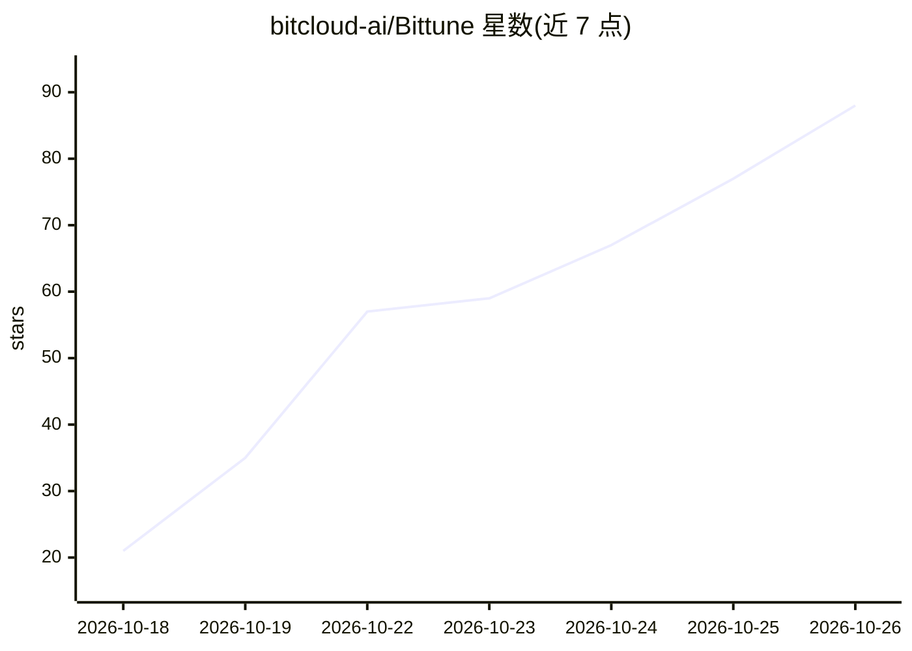

# bitcloud-ai/Bittune

⭐ 88 · TypeScript · MIT · 推送 2026-08-31 · [GitHub](https://github.com/bitcloud-ai/Bittune) · 组织维护 · 中文 README

**本地推理工程智能体：自然语言驱动 vLLM/SGLang 部署压测调优**

运行在用户自有 GPU 机器上的推理工程智能体：以自然语言下达目标后，执行环境检查、本机模型发现、vLLM/SGLang 受管部署、EvalScope 压测与参数调优，并将结论记录为绑定环境指纹与配置 Hash 的可复核执行证据（Run Record/Artifact）。通过静态 Domain Tool Registry 提供受管操作，需配置 OpenAI-compatible Agent LLM 才能启动。以 Linux x86_64 tar.gz 安装包分发，安装器自带固定版本 Node.js，需 root 或 docker 组权限；GPU、Docker、NVIDIA Container Toolkit 为按需前置。

## 筛选速览

| 维度 | 判定 | 备注 |
|---|---|---|
| AI 角色 | `ai-ecosystem` | LLM/agent 周边工具 |
| 许可风险 | `permissive` | MIT |
| 部署形态 | `library` | 以包/库形式分发 |
| 模型依赖 | local-ok | 支持本地模型 |
| 硬件要求 | — | 无带数字的原话,不猜 |
| 安装摩擦 | `low` | 无编译、无系统依赖或容器化 |
| 成熟度 | — | 结构信号不足 |

## 能力要点

- 自然语言驱动 vLLM/SGLang 服务部署、EvalScope 压测与参数调优
- 性能结论绑定环境指纹与配置 Hash，失败与容量边界留痕可复核
- Domain Tool Registry 受管操作，可选只读 MCP 接入
- 在线/离线同一安装命令，离线包不访问网络

## 适用场景

- 在我的 GPU 机器上部署并调优 vLLM/SGLang 推理服务
- 对推理服务做可复现的性能压测与容量边界探索
- 留存每一步部署与调优的可审计执行证据

## 场景标签

`推理引擎` · 领域:训练与推理

## 证据(README 行号)

> L9: Bittune 是运行在你自己 GPU 机器上的**推理工程智能体**：你用自然语言说清目标，它替你完成环境检查、模型选择、vLLM/SGLang 服务部署、性能压测和参数调优，并把每一步的结论记录成可复核的执行证据。
> L31: - 用受限配置创建并管理 vLLM 或 SGLang 服务，独立执行启动、就绪检查、端点探测、日志读取和停止。

## 星数曲线

2026-10-18 21 → 2026-10-26 88（+67）

---
*卡片 v1 · prompt 1.4 · 生成 2026-10-24 · 置信度 high · 依据 README sha `56ae420a5a0b` · [字段定义](../../DATASET.md)*
