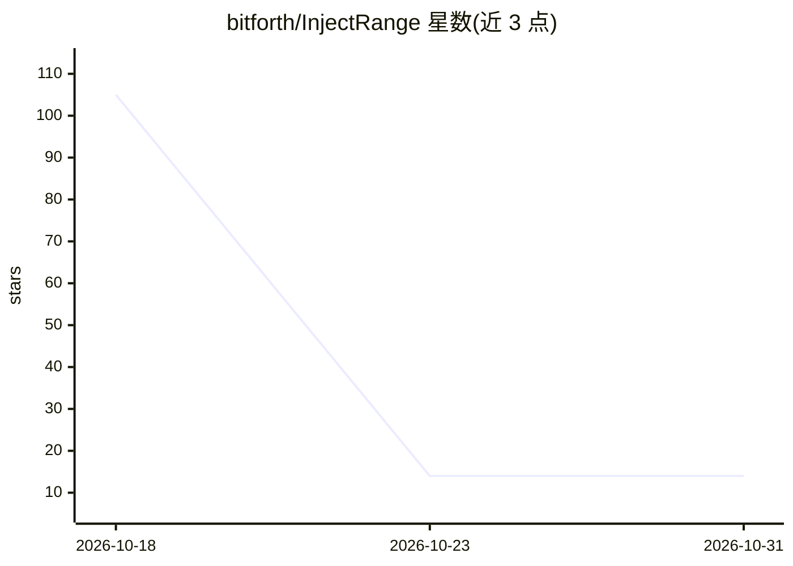

# bitforth/InjectRange

⭐ 14 · Python · MIT · 推送 2026-09-26 · [GitHub](https://github.com/bitforth/InjectRange) · 个人维护

**提示注入防护规则的确定性回归评测工具**

InjectRange 是面向开发者自声明防护规则的评测 harness：用 24 条哈希固定的合成模式骨架（覆盖指令覆盖、角色混淆、分隔符逃逸、编码走私、工具胁迫、外泄框架六类）测试用户编写的防护配置，输出按类别的违规矩阵而非单一分数，便于在两次提交间发现防护悄然变弱。不调用模型、不联网，同一语料与配置结果可复现。提供 run/corpus/diff/version 四个 CLI 子命令；防护规则为大小写不敏感的子串匹配；语料以 sha256 规范化摘要固定，不匹配即拒绝运行。参考防护仅为子串匹配器，非生产过滤器。

## 筛选速览

| 维度 | 判定 | 备注 |
|---|---|---|
| AI 角色 | `ai-ecosystem` | LLM/agent 周边工具 |
| 许可风险 | `permissive` | MIT |
| 部署形态 | `library` | 以包/库形式分发 |
| 模型依赖 | — | README 未给出锁定关系 |
| 硬件要求 | — | 无带数字的原话,不猜 |
| 安装摩擦 | `low` | 无编译、无系统依赖或容器化 |
| 成熟度 | — | 结构信号不足 |

## 能力要点

- 24 条哈希固定合成语料，六类违规逐类报告
- diff 子命令对比两版防护配置的逐类变化
- 语料 sha256 规范化摘要固定，不匹配即报错拒绝运行
- 纯标准库实现，无网络访问，输出确定可提交 git

## 适用场景

- 在 CI 中检测防护规则在两次提交间的回归
- 对比严格与宽松防护配置的逐类覆盖差异
- 验证语料文件未被静默改动

## 场景标签

`模型评测` `网络安全` · 领域:评测与运维

## 证据(README 行号)

> L16: injectrange evaluates a locally declared guard configuration against a fixed,
> L20: point. It tests the guard you wrote, not any model, and it never reaches the
> L86: |`run <guard>`|Evaluate one guard config against the pinned corpus.|guard JSON, corpus JSON|per-class breach matrix

## 星数曲线

2026-10-18 105 → 2026-10-31 14（-91）

---
*卡片 v1 · prompt 1.4 · 生成 2026-10-31 · 置信度 mid · 依据 README sha `ac3faab51794` · [字段定义](../../DATASET.md)*
