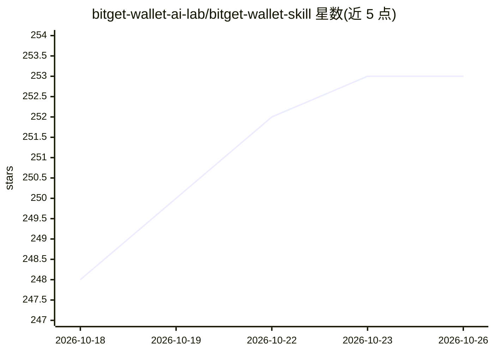

# bitget-wallet-ai-lab/bitget-wallet-skill

⭐ 253 · Python · MIT · 推送 2026-05-13 · [GitHub](https://github.com/bitget-wallet-ai-lab/bitget-wallet-skill) · [官网](https://web3.bitget.com) · 组织维护

**面向 AI agent 的 Bitget Wallet 链上操作技能包：查询、换币与跨链**

封装 Bitget Wallet 生产 API 的 Python 技能源码包，供 OpenClaw、Dify、LangChain 等 agent 框架作为工具调用，实现代币发现与安全审计、行情与持仓查询、Swap 报价下单、跨链一步兑换、Gasless 转账（EIP-7702，Gas 从 USDT/USDC 扣除）及 x402 支付。默认人机协同：agent 只生成交易数据，签名需用户确认。Solana 签名为纯 Python 实现，无需额外安装包；EVM 签名依赖 eth-account。支持 9 条链的兑换与 32+ 条链的行情数据。

## 筛选速览

| 维度 | 判定 | 备注 |
|---|---|---|
| AI 角色 | `ai-ecosystem` | LLM/agent 周边工具 |
| 许可风险 | `permissive` | MIT |
| 部署形态 | `library` | 以包/库形式分发 |
| 模型依赖 | — | README 未给出锁定关系 |
| 硬件要求 | — | 无带数字的原话,不猜 |
| 安装摩擦 | `low` | 无编译、无系统依赖或容器化 |
| 成熟度 | — | 结构信号不足 |

## 能力要点

- 自然语言驱动的链上数据查询与 Swap 操作工具集（含蜜罐检测、聪明钱分析等 20+ 能力）
- EIP-7702 Gasless：零原生代币余额即可换币/转账，Gas 从稳定币扣除
- 单笔订单完成跨链兑换，无需手动桥接
- x402 支付：以 USDC 支付按请求计费的 API 访问

## 适用场景

- 让 Telegram/Discord 机器人回答币价、持仓与安全审计问题
- 构建半自动交易 agent：报价→确认→签名执行
- 监控榜单与交易量并自动推送预警
- 作为 Dify/LangChain 工具节点或 MCP Server 接入企业 agent 平台

## 场景标签

 · 领域:Web3/DeFi 工具

## 证据(README 行号)

> L5: An AI Agent skill that wraps the Bitget Wallet API, enabling natural-language-driven on-chain data queries and swap 
> L158: AI Agent (OpenClaw / Dify / Custom)
> L219: - `bitget-wallet-agent-api.py` can serve directly as a Dify Code node or external API Tool

## 星数曲线

2026-10-18 248 → 2026-10-26 253（+5）

---
*卡片 v1 · prompt 1.4 · 生成 2026-10-22 · 置信度 mid · 依据 README sha `cfe8bb007fdd` · [字段定义](../../DATASET.md)*
