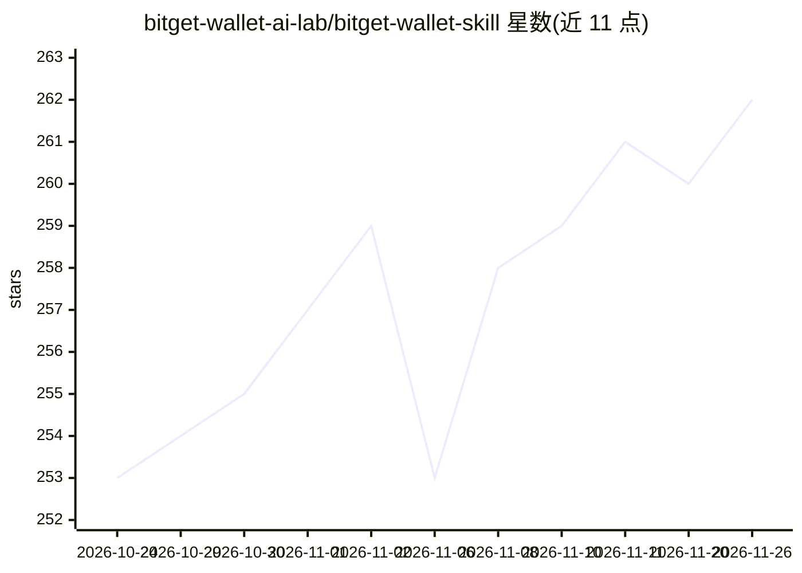

# bitget-wallet-ai-lab/bitget-wallet-skill

⭐ 262 · Python · MIT · 推送 2026-10-30 · [GitHub](https://github.com/bitget-wallet-ai-lab/bitget-wallet-skill) · [官网](https://web3.bitget.com) · 组织维护 · 中文 README

**给 AI agent 接入 Bitget Wallet 链上查询与兑换的技能包**

封装 Bitget Wallet API 的 AI agent 技能：提供代币发现、安全审计、K 线、持币与聪明钱分析等市场工具，以及同链/跨链兑换、无 gas 转账（EIP-7702）与 x402 支付。资金操作采用 human-in-the-loop：agent 仅生成待签交易数据，签名需用户钱包密钥。零外部依赖，Python 3.9+ 加 requests/eth-account 即可运行，Solana 签名纯 Python 实现。支持 7 条 EVM 链加 Solana，可作为 Dify/LangChain 工具节点或 MCP Server。

## 筛选速览

| 维度 | 判定 | 备注 |
|---|---|---|
| AI 角色 | `ai-ecosystem` | LLM/agent 周边工具 |
| 许可风险 | `permissive` | MIT |
| 部署形态 | `library` | 以包/库形式分发 |
| 模型依赖 | — | README 未给出锁定关系 |
| 硬件要求 | — | 无带数字的原话,不猜 |
| 安装摩擦 | `low` | 无编译、无系统依赖或容器化 |
| 成熟度 | — | 结构信号不足 |

## 能力要点

- Order Mode 实现无 gas（EIP-7702）与一步跨链兑换
- 35+ 原子工具覆盖代币发现、安全审计、K 线、聪明钱分析
- human-in-the-loop 设计：agent 只生成交易数据，签名需用户确认
- 可作为 Dify Code 节点、LangChain 工具或 MCP Server 接入

## 适用场景

- 查一个 meme 币是否安全并获取价格报价
- 跨链查询与管理多链投资组合总值
- 在 Dify 工作流中接入链上行情与兑换工具
- 自动扫描新池并过滤蜜罐后推送提醒

## 场景标签

`金融量化` · 领域:学习与行业

## 证据(README 行号)

> L5: An AI Agent skill that wraps the Bitget Wallet API, enabling natural-language-driven on-chain data queries and swap 
> L13: |**API Infrastructure, Not Reimplementation**|Capabilities come from Bitget Wallet's production API. The skill prov
> L156: AI Agent (OpenClaw / Dify / Custom)

## 星数曲线

2026-10-24 253 → 2026-11-26 262（+9）

---
*卡片 v1 · prompt 1.4 · 生成 2026-11-25 · 置信度 mid · 依据 README sha `32e1470f31b2` · [字段定义](../../DATASET.md)*
