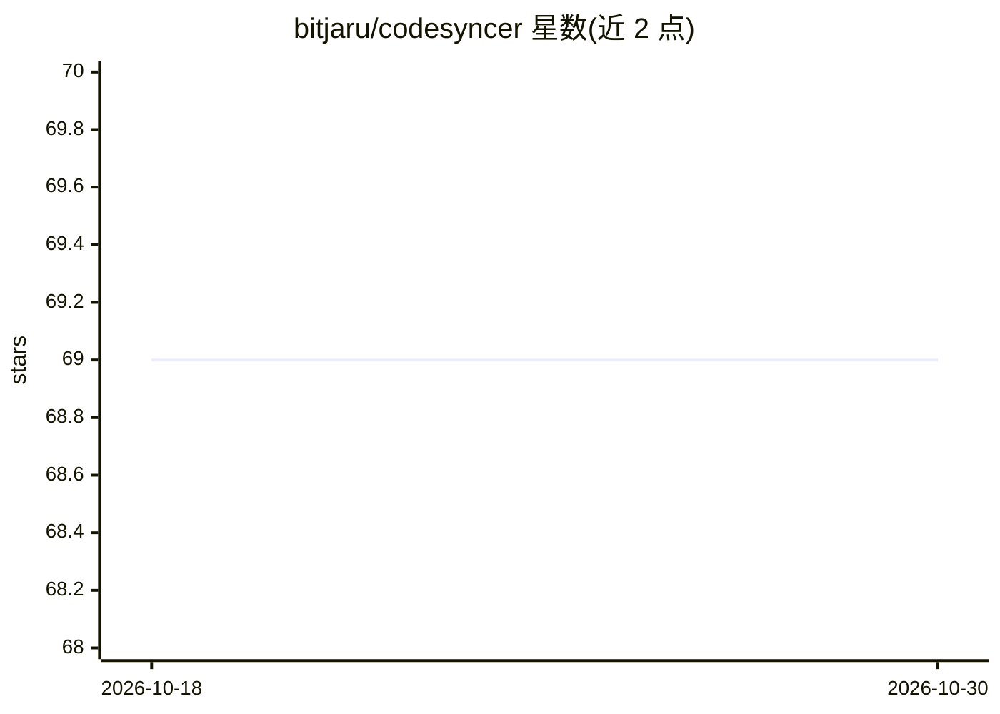

# bitjaru/codesyncer

⭐ 69 · TypeScript · NOASSERTION · 推送 2026-01-23 · [GitHub](https://github.com/bitjaru/codesyncer) · [官网](https://www.npmjs.com/package/codesyncer) · 个人维护 · 中文 README

**让 Claude Code 跨会话保留项目记忆与规则的 CLI 工具**

面向使用 Claude Code 的开发者的 npm CLI 工具，解决会话结束后上下文丢失的问题。机制包括：在代码中写入 @codesyncer-* 注释标签使 AI 读代码时自动恢复上下文；watch 模式实时监测未标记的变更并归档到 DECISIONS.md；通过 Claude Code 的 Hooks（SessionStart/PreCompact）在适当时机注入规则。Claude Code 为完整支持，Cursor 与 GitHub Copilot 标注为 Coming soon。许可证为 Commons Clause + MIT，个人/非商业用途免费。

## 筛选速览

| 维度 | 判定 | 备注 |
|---|---|---|
| AI 角色 | `ai-ecosystem` | LLM/agent 周边工具 |
| 许可风险 | `none` | NOASSERTION |
| 部署形态 | `library` | 以包/库形式分发 |
| 模型依赖 | locked-api |  |
| 硬件要求 | — | 无带数字的原话,不猜 |
| 安装摩擦 | `low` | 无编译、无系统依赖或容器化 |
| 成熟度 | — | 结构信号不足 |

## 能力要点

- 代码内 @codesyncer-* 标签体系，AI 读代码即恢复上下文
- watch 模式实时捕获未标记的变更并写入文档
- Hooks 在 SessionStart/PreCompact 时机注入规则
- 提供 init/update/validate/watch 等 CLI 命令

## 适用场景

- 让 Claude Code 在新会话中保留项目决策与规则
- 自动归档代码变更中的决策到文档
- 防止 AI 在会话中遗忘项目规范

## 场景标签

`Agent 记忆` · 领域:Agent 开发

## 证据(README 行号)

> L3: > **Claude forgets everything when the session ends. CodeSyncer makes it remember.**
> L86: |**Claude Code**|✅ Full support|

## 星数曲线

2026-10-18 69 → 2026-10-30 69（+0）

---
*卡片 v1 · prompt 1.4 · 生成 2026-10-24 · 置信度 high · 依据 README sha `0716ff14bc2e` · [字段定义](../../DATASET.md)*
