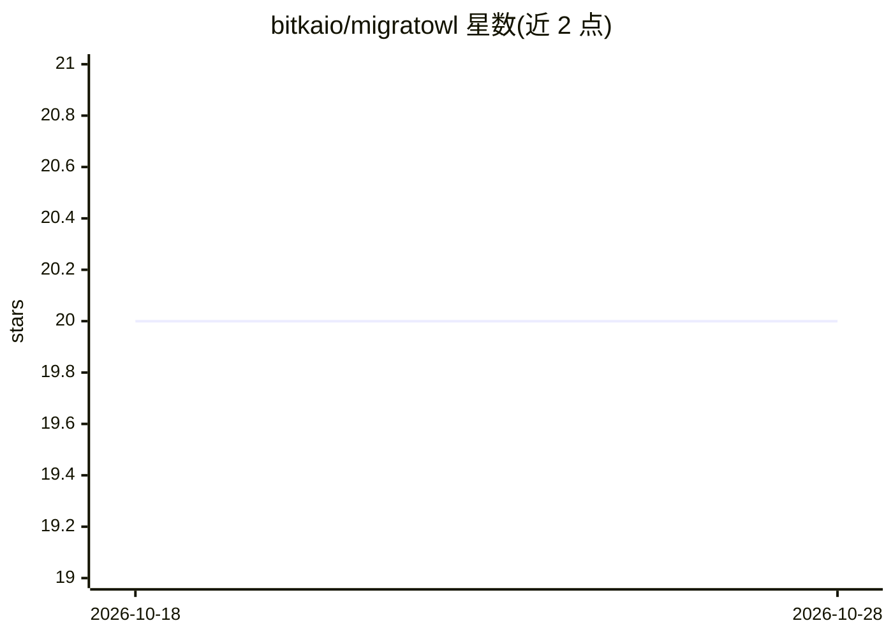

# bitkaio/migratowl

⭐ 20 · Python · Apache-2.0 · 推送 2026-10-28 · [GitHub](https://github.com/bitkaio/migratowl) · [官网](https://migratowl.bitkaio.com) · 组织维护

**AI 依赖升级分析器：沙箱实测并解释依赖升级是否会破坏项目**

面向开发团队的依赖迁移分析工具：接收 webhook 后克隆仓库，扫描 Python/Node.js/Go/Rust/Java 的依赖清单与锁文件，查询 registry 最新版本，在临时 Kubernetes 沙箱中将依赖全部升版后执行测试；AI agent（默认 Claude 模型）读取真实报错、结合 ast-grep 静态分析与 changelog 引文，逐依赖产出是否破坏、原因定位与修复建议的结构化报告，并可在 PR/MR 上评论与设置 commit 状态。提供 GitHub Actions/GitLab CI 零配置接入与 Kubernetes 自托管两种方式；解释型语言目前需有测试套件才能检测运行时破坏。

## 筛选速览

| 维度 | 判定 | 备注 |
|---|---|---|
| AI 角色 | `ai-native` | 本体是模型或模型工具 |
| 许可风险 | `permissive` | Apache-2.0 |
| 部署形态 | `self-host` | docker 或自建部署 |
| 模型依赖 | locked-api |  |
| 硬件要求 | — | 无带数字的原话,不猜 |
| 安装摩擦 | `low` | 无编译、无系统依赖或容器化 |
| 成熟度 | — | 结构信号不足 |

## 能力要点

- 在临时 Kubernetes 沙箱中升版依赖并实际运行测试，AI 仅做失败归因判断
- 逐依赖给出破坏性判定、changelog 原文引文与修复建议，含置信度阈值（默认 0.7，可配置）
- ast-grep 静态分析定位受影响文件与调用点，代码（非模型）复核 safe 结论
- 支持 Python/Node.js/Go/Rust/Java 五种生态的清单与锁文件解析

## 适用场景

- 在 PR 中自动判断依赖升级是否破坏项目并定位原因
- 为缺乏 CI 配置或只有少量测试的仓库做升级前检查
- 按 changelog 引文解释依赖升级破坏的具体来源

## 场景标签

`代码审查` · 领域:编码与开发

## 证据(README 行号)

> L18: It receives a webhook, clones the target repository, scans all dependency manifests, queries package registries for
> L116: plain code (`migratowl/pipeline.py`); the LLM only does the judgement step (Phase 3), and the
> L142: **Choosing a model:** the default `claude-sonnet-5-5` gives the most precise verdicts; a scan of a small project c

## 星数曲线

2026-10-18 20 → 2026-10-28 20（+0）

---
*卡片 v1 · prompt 1.4 · 生成 2026-10-28 · 置信度 mid · 依据 README sha `627b673f23ec` · [字段定义](../../DATASET.md)*
