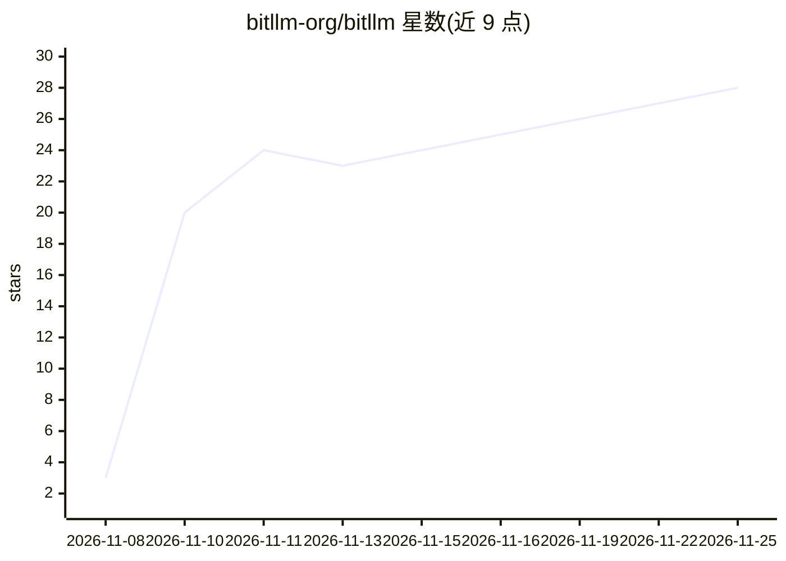

# bitllm-org/bitllm

⭐ 28 · Go · MIT · 推送 2026-11-23 · [GitHub](https://github.com/bitllm-org/bitllm) · [官网](https://bitllm.org) · 组织维护 · 中文 README

**P2P 网络共享本地 LLM 推理的节点与网关二进制**

单个 Go 二进制承担四种角色：本机网关（监听 127.0.0.1:7778，说 OpenAI 与 Anthropic 协议）、共享节点（--upstream 指向本机已有的 OpenAI 兼容服务如 vLLM/Ollama/llama.cpp）、公共中继与种子。节点通过 Kademlia DHT 与 gossip 互相发现，NAT 后双方经中继加打洞连接，无协调器、无账号、无钱包。面向本地 LLM 运行者与 agent 开发者；自称 Beta，网络已上线 bitllm.org。提供 install.sh/install.ps1 脚本安装预编译二进制。

## 筛选速览

| 维度 | 判定 | 备注 |
|---|---|---|
| AI 角色 | `ai-ecosystem` | LLM/agent 周边工具 |
| 许可风险 | `permissive` | MIT |
| 部署形态 | `desktop` | 安装包/桌面程序 |
| 模型依赖 | local-ok | 支持本地模型 |
| 硬件要求 | — | 无带数字的原话,不猜 |
| 安装摩擦 | `low` | 无编译、无系统依赖或容器化 |
| 成熟度 | `idea` | |

## 能力要点

- 无协调器的 P2P 发现：DNS 种子 + Kademlia DHT + gossip
- 网关同时说 OpenAI 与 Anthropic 协议，agent 可直接指向
- serving 节点可位于 NAT 后，经中继与打洞对外服务，无需端口转发
- 模型名采用 Hugging Face repo id，同权重多主机可互换与故障切换

## 适用场景

- 把我在本机跑的 vLLM/Ollama 模型共享给网络中的其他节点
- 不 own GPU 时通过本机网关调用他人共享的模型
- 给 agent 提供一个指向 P2P 网络的本地 OpenAI 兼容 API

## 场景标签

`模型网关` · 领域:Agent 开发

## 证据(README 行号)

> L13: Every node runs the same binary. It can share an OpenAI-compatible server you already run
> L36: - **Your node** runs the same binary as everyone else. Its gateway listens on
> L37:  `127.0.0.1:7778` and speaks OpenAI and Anthropic, so an agent points at it

## 星数曲线

2026-11-08 3 → 2026-11-25 28（+25）

---
*卡片 v1 · prompt 1.4 · 生成 2026-11-18 · 置信度 high · 依据 README sha `e35634c107f9` · [字段定义](../../DATASET.md)*
