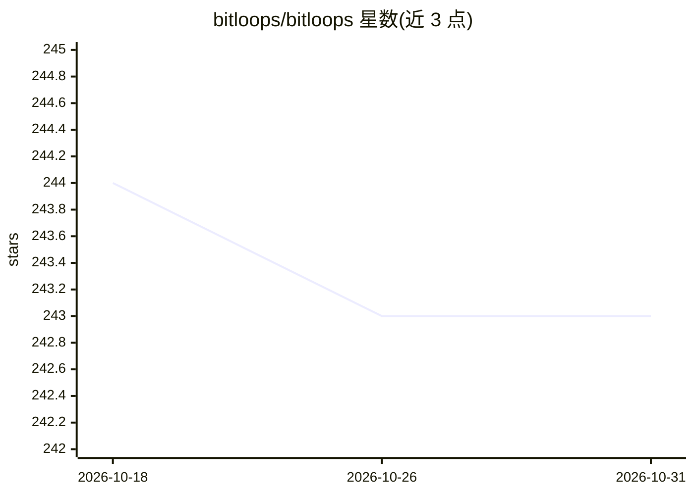

# bitloops/bitloops

⭐ 243 · Rust · Apache-2.0 · 推送 2026-06-01 · [GitHub](https://github.com/bitloops/bitloops) · [官网](https://bitloops.com) · 组织维护

**为 AI 编程 agent 提供持久化代码库上下文的本地运行时**

本地运行的后台守护进程，从 agent 会话与提交中自动捕获决策、约束与上下文，把文件、符号、依赖、测试与历史建模为可查询图谱，并按相关性回灌到后续 prompt，替代手工维护的 CLAUDE.md/.cursor/rules/AGENTS.md。支持 Claude Code、Codex、Cursor、Gemini、Copilot、OpenCode 六种 agent 与多种语言，提供 DevQL 查询语言、本地仪表盘与提交溯源。代码不存储在厂商基础设施，但 LLM 处理需账户认证并向模型提供方发送内容。

## 筛选速览

| 维度 | 判定 | 备注 |
|---|---|---|
| AI 角色 | `ai-ecosystem` | LLM/agent 周边工具 |
| 许可风险 | `permissive` | Apache-2.0 |
| 部署形态 | `None` |  |
| 模型依赖 | — | README 未给出锁定关系 |
| 硬件要求 | — | 无带数字的原话,不猜 |
| 安装摩擦 | `low` | 无编译、无系统依赖或容器化 |
| 成熟度 | — | 结构信号不足 |

## 能力要点

- 从 agent 会话自动捕获决策与约束，无需手工维护规则文件
- 代码库建模为可查询图谱，提供 DevQL 类型化查询语言
- 跨 agent 共享同一上下文底座（六种 agent）
- 本地优先：守护进程在本地运行，代码处理而非存储

## 适用场景

- AI 编程 agent 每次会话都要重新解释架构与约束
- 多个 agent（Claude Code/Cursor/Copilot）间共享项目记忆
- 团队需要 AI 辅助工作的 prompt/决策/提交审计线索

## 场景标签

`Agent 记忆` · 领域:Agent 开发

## 证据(README 行号)

> L4:  Your AI agent forgets your codebase between sessions. You re-explain the architecture, re-paste rules, re-list cons
> L66: - 🧠 **Persistent codebase substrate** — files, symbols, dependencies, tests, and history modeled as a queryable gra
> L73: - 🔒 **Local-first** — your code isn't stored on our infrastructure. The daemon runs on your machine.

## 星数曲线

2026-10-18 244 → 2026-10-31 243（-1）

---
*卡片 v1 · prompt 1.4 · 生成 2026-10-22 · 置信度 high · 依据 README sha `67eb1d6f010e` · [字段定义](../../DATASET.md)*
