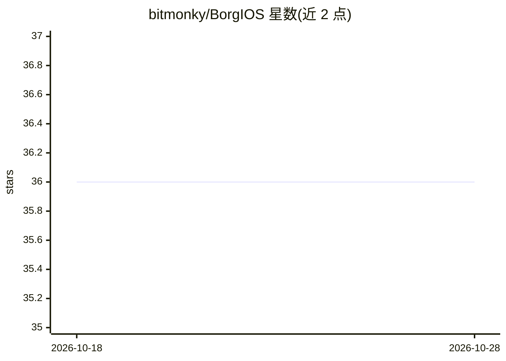

# bitmonky/BorgIOS

⭐ 36 · JavaScript · GPL-3.0 · 推送 2026-10-08 · [GitHub](https://github.com/bitmonky/BorgIOS) · 个人维护

**自组织 P2P 分布式网络操作系统，内含 AI 代理集群**

无中心服务器的对等网络操作系统：节点为相同克隆，自组织为浅层广播树，以 EC 密钥对与时间戳签名消息实现身份、认证与访问控制；数据切分为 SHA-256 分片经工作量证明随机分布存储，网络自愈。功能以隔离的 cell 进程组织，覆盖存储、流媒体、网络时间、账本货币 Borg Shells、交易与文件管理等。AI 层为 borgAgentCell 代理集群：读取代码库存入签名分片记忆、自然语言检索、互签消息、自选专长、改写自身提示词，经 DeepSeek R1 测试。用户通过 NodeJS 客户端 BorgHUI 接入。项目自声明实验性、不建议生产使用。

## 筛选速览

| 维度 | 判定 | 备注 |
|---|---|---|
| AI 角色 | `ai-enhanced` | 去掉 AI 部分产品仍成立 |
| 许可风险 | `viral` | GPL-3.0 |
| 部署形态 | `None` |  |
| 模型依赖 | — | README 未给出锁定关系 |
| 硬件要求 | — | 无带数字的原话,不猜 |
| 安装摩擦 | `low` | 无编译、无系统依赖或容器化 |
| 成熟度 | `idea` | |

## 能力要点

- 节点自组织浅层广播树，百万节点 6 跳可达
- SHA-256 签名分片存储与读取触发自愈复制
- EC 密钥对+时间戳签名统一各层身份与授权，无登录/无 CA/无域名
- Mnemosyne 协议 AI 代理集群：持久分片记忆、自然语言检索、自改写提示词

## 适用场景

- 搭建无中心服务器的对等分布式服务网络
- 运行可持久化记忆、互相协作的 AI 代理集群
- 在无域名/无证书机构环境下做签名分片存储与流媒体分发

## 场景标签

`Agent 记忆` `多智能体` · 领域:Agent 开发

## 证据(README 行号)

> L14: BorgIOS is a peer-to-peer network operating system where services are self organizing networks of identical cells.
> L199: ### borgAgentCell — The Mnemosyne Protocol

## 星数曲线

2026-10-18 36 → 2026-10-28 36（+0）

---
*卡片 v1 · prompt 1.4 · 生成 2026-10-25 · 置信度 high · 依据 README sha `75ec9a2633f0` · [字段定义](../../DATASET.md)*
