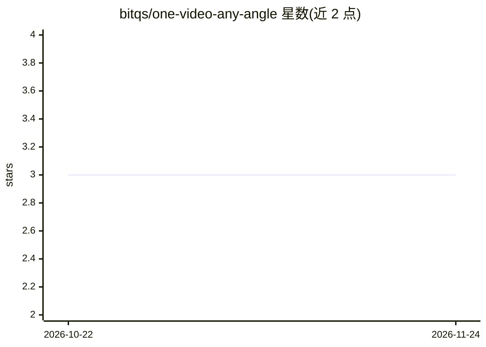

# bitqs/one-video-any-angle

⭐ — · [GitHub]() · 个人维护 · 中文 README

**给内容创作者的 AI 视频工作流：从原片提取动作生成任意机位多风格视频**

一套以文档形式发布的七步视频重制流程：从原视频提取节拍与 2D/3D 人体动作（YOLO11x-pose、GVHMR、SMPL-X），生成 clay 动作参考，再调用 Seedance 2.5 按设计机位与风格生成镜头，最后对拍校正、调色包装为竖屏成片。仓库主体是 AGENTS.md 执行手册与流程文档，供 Claude Code/Codex/Cursor 等 agent 读取执行；参考脚本尚未发布。文档按 CC BY-NC 4.0 开放，生成按秒计费。

## 筛选速览

| 维度 | 判定 | 备注 |
|---|---|---|
| AI 角色 | `ai-knowledge` | 知识聚合/清单类 |
| 许可风险 | `none` | — |
| 部署形态 | `None` |  |
| 模型依赖 | — | README 未给出锁定关系 |
| 硬件要求 | `gpu-8g` | |
| 安装摩擦 | `medium` | 含编译或系统依赖之一 |
| 成熟度 | — | 结构信号不足 |

## 能力要点

- 一份 3D 动作母带驱动任意机位与多风格镜头（环绕/俯拍/贴地/穿越机）
- AGENTS.md 提供 agent 执行所需的不变式、参数、验收门槛与估价公式
- 七步流程覆盖素材节拍、动作提取、3D 拟合、clay 参考、Seedance 生成与对拍校正
- 给出实测成本数据：96 秒竖版 11 个 AI 镜头花费 ¥419

## 适用场景

- 把舞蹈/武术/体育表演视频重制为多角度多风格的 AI 短视频
- 按抖音安全区与音乐重音制作竖屏卡点视频
- 交给 AI agent 自动执行整套视频重制流程

## 场景标签

`视频生成` · 领域:内容生成

## 证据(README 行号)

> L43: 这个仓库是写给 agent 读的。把下面这段话丢给 Claude Code / Codex / Cursor：
> L51: AGENTS.md 里有 agent 需要的全部东西：不变式、要问人的问题、数据格式、每一步的参数和验收门槛、Seedance 请求体、对拍算法、故障速查、估价公式。
> L71: |步|做什么|关键工具|产物|文档|

## 星数曲线

2026-10-22 3 → 2026-11-24 3（+0）

---
*卡片 v1 · prompt 1.4 · 生成 2026-11-22 · 置信度 mid · 依据 README sha `3702a913b756` · [字段定义](../../DATASET.md)*
