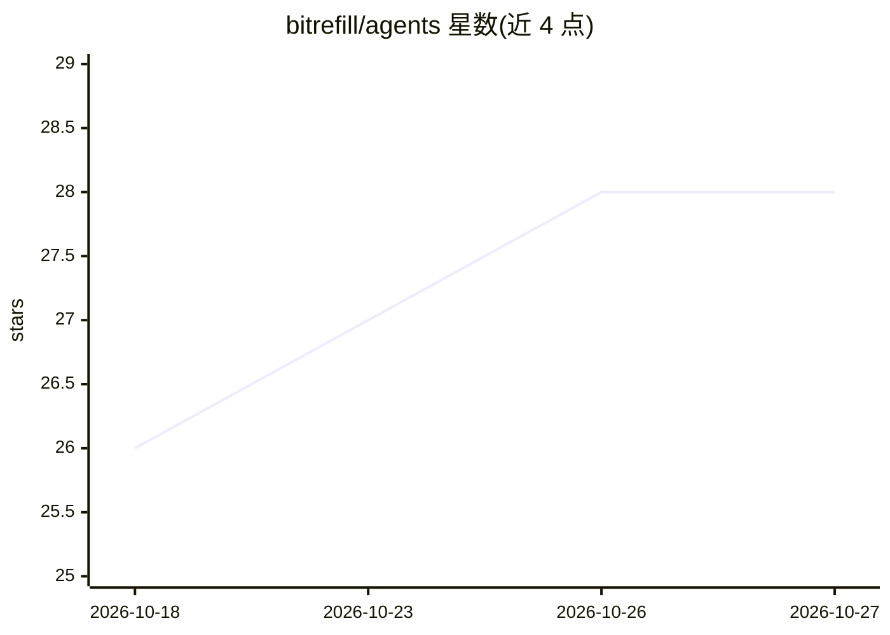

# bitrefill/agents

⭐ 28 · JavaScript · MIT · 推送 2026-10-20 · [GitHub](https://github.com/bitrefill/agents) · [官网](https://www.bitrefill.com) · 组织维护

**让 AI agent 浏览购买 Bitrefill 礼品卡/充值/eSIM 的技能插件**

Bitrefill 官方发布的 Agent Skills 技能包，为 AI 编码 agent（Claude Code、Cursor、Grok Bot、OpenClaw 等）提供浏览、购买、管理礼品卡、手机充值与 eSIM 的能力，覆盖 180+ 国家，支持 crypto、Lightning、USDC via x402、账户余额、银行卡及 Apple/Google Pay 等支付路由。技能按 harness × touchpoint × wallet 三层做能力探测与路由，附带 eCommerce MCP（OAuth 连接 Bitrefill 账户），未连接账户时可经 npm CLI 以访客身份结算。

## 筛选速览

| 维度 | 判定 | 备注 |
|---|---|---|
| AI 角色 | `ai-ecosystem` | LLM/agent 周边工具 |
| 许可风险 | `permissive` | MIT |
| 部署形态 | `library` | 以包/库形式分发 |
| 模型依赖 | — | README 未给出锁定关系 |
| 硬件要求 | — | 无带数字的原话,不猜 |
| 安装摩擦 | `low` | 无编译、无系统依赖或容器化 |
| 成熟度 | — | 结构信号不足 |

## 能力要点

- 能力驱动的三层路由：探测 harness → 选 touchpoint（MCP/x402 REST/CLI/API/browse）→ 选钱包
- 附带 eCommerce MCP，OAuth 连接 Bitrefill 账户
- 支持 Claude Code/Cowork 插件市场、Cursor、Grok Bot、OpenClaw 与 npx skills 多宿主安装
- 覆盖 180+ 国家的礼品卡、充值与 eSIM，支付含 crypto/Lightning/x402/Apple Pay

## 适用场景

- 在 Claude Code 或 Cursor 中直接下单购买礼品卡与手机充值
- 让 agent 管理我的 Bitrefill 账户余额与订单
- 为 OpenClaw agent 接入 Bitrefill 的类型化购买工具

## 场景标签

 · 领域:电商/加密支付 agent 集成

## 证据(README 行号)

> L3: A unified, capability-aware agent skill for Bitrefill — enabling AI agents to browse, buy, and manage gift cards, mo
> L11: |Plugin|`.claude-plugin/marketplace.json` + manifest; includes eCommerce MCP via root `.mcp.json` (Claude Code / Co
> L79: |`bitrefill`|Capability-driven routing: probe harness (exec, egress, MCP), pick touchpoint (Bitrefill MCP, x402 RES

## 星数曲线

2026-10-18 26 → 2026-10-27 28（+2）

---
*卡片 v1 · prompt 1.4 · 生成 2026-10-26 · 置信度 high · 依据 README sha `4ff75245d5e5` · [字段定义](../../DATASET.md)*
