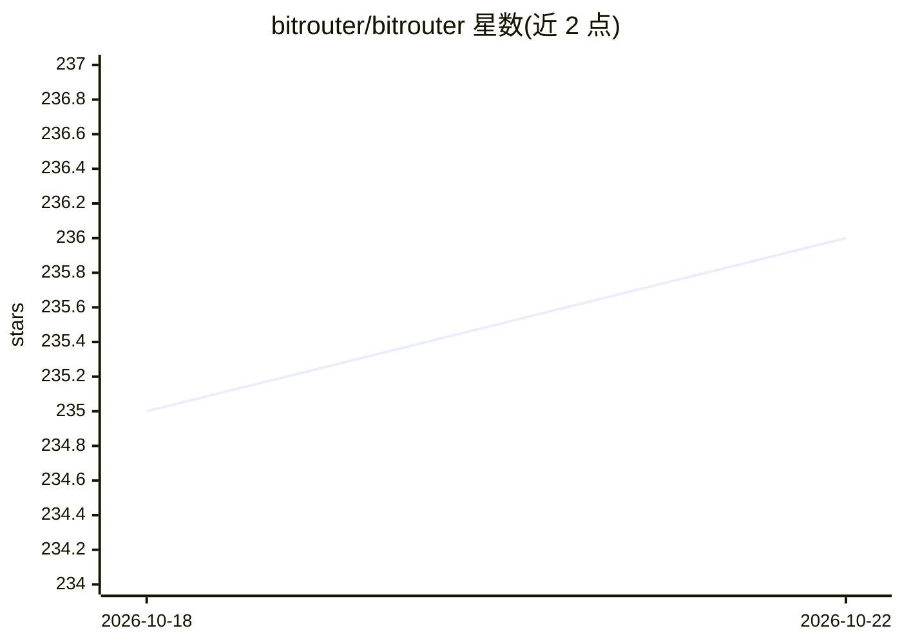

# bitrouter/bitrouter

⭐ 236 · Rust · Apache-2.0 · 推送 2026-10-21 · [GitHub](https://github.com/bitrouter/bitrouter) · [官网](https://bitrouter.ai) · 组织维护

**本地运行的 OpenAI 兼容模型路由器，按策略在多模型间路由**

用 Rust 编写的本地模型路由网关：暴露 OpenAI 兼容 API，置于 agent 与各模型提供商之间，按文件化的路由策略在多个模型/提供商间选择与降级回退，支持跨协议路由（OpenAI Chat/Responses 与 Anthropic Messages）。提供 `bro` CLI 启动 Codex/Claude 编码代理（ACP 适配器）、MCP 服务器聚合、策略检查与发布/回滚。内置 `bitrouter/auto` 自动路由，从准入的结果中学习并提议新策略；另有 BitRouter Cloud 托管服务。当前版本为 v1.0.0-alpha.33。

## 筛选速览

| 维度 | 判定 | 备注 |
|---|---|---|
| AI 角色 | `ai-ecosystem` | LLM/agent 周边工具 |
| 许可风险 | `permissive` | Apache-2.0 |
| 部署形态 | `library` | 以包/库形式分发 |
| 模型依赖 | locked-api |  |
| 硬件要求 | — | 无带数字的原话,不猜 |
| 安装摩擦 | `low` | 无编译、无系统依赖或容器化 |
| 成熟度 | `idea` | |

## 能力要点

- OpenAI 兼容 API，现有 agent 仅改 base_url 即可接入
- 路由策略存于本地文件，可检查、diff、显式发布或回滚
- `bro` CLI 支持 Codex/Claude ACP 会话与无头单轮执行
- 聚合 MCP 服务器与技能于同一网关端点

## 适用场景

- 让编码代理在多个模型间按成本/性能策略自动路由
- 统一管理多家模型提供商的接入与回退
- 审查并控制 agent 工作流的模型路由决策

## 场景标签

`模型网关` · 领域:Agent 开发

## 证据(README 行号)

> L13: **The minimal interpretable model router that learns & adapts to your agent workflows.**
> L30: BitRouter runs locally and exposes an OpenAI-compatible API, so existing agents and tools can switch over with mini
> L44: One Rust router sits between your agents and every model provider. Extend it

## 星数曲线

2026-10-18 235 → 2026-10-22 236（+1）

---
*卡片 v1 · prompt 1.4 · 生成 2026-10-22 · 置信度 mid · 依据 README sha `6f5c07da1f70` · [字段定义](../../DATASET.md)*
