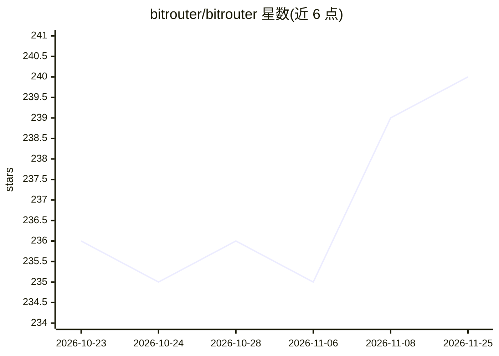

# bitrouter/bitrouter

⭐ 240 · Rust · Apache-2.0 · 推送 2026-11-23 · [GitHub](https://github.com/bitrouter/bitrouter) · [官网](https://bitrouter.ai) · 组织维护

**可部署的模型网关：为 agent 工作负载提供可审计的路由**

用 Rust 编写的本地模型网关，在 agent 与模型提供方之间做路由：暴露 OpenAI 兼容 API 与 Anthropic Messages 协议并支持跨协议路由，agent 将 base URL 指向本地实例后可用 `bitrouter/auto` 选择器自动选模型。路由策略保存在用户自有的文件中，策略变更需操作者显式发布才生效；路由按配置的 provider 优先级排序并支持失败回退。通过 cargo 从源码安装，提供 `bitrouter` 服务与可选的 `bro` 本地 harness 两个包，另提供托管云版本与 BYOK 模式。

## 筛选速览

| 维度 | 判定 | 备注 |
|---|---|---|
| AI 角色 | `ai-ecosystem` | LLM/agent 周边工具 |
| 许可风险 | `permissive` | Apache-2.0 |
| 部署形态 | `library` | 以包/库形式分发 |
| 模型依赖 | locked-api |  |
| 硬件要求 | — | 无带数字的原话,不猜 |
| 安装摩擦 | `low` | 无编译、无系统依赖或容器化 |
| 成熟度 | — | 结构信号不足 |

## 能力要点

- 本地运行、暴露 OpenAI 兼容 API（默认 127.0.0.1:4356）
- 路由策略以自有文件保存，可 diff、需显式发布
- 支持 OpenAI Chat/Responses 与 Anthropic Messages 的跨协议路由
- 通过 `bitrouter mcp` 配置上游 MCP 服务器工具

## 适用场景

- 给编码 agent 接入一个可控制路由策略的本地网关
- 在多个模型间动态路由以降低 API 成本
- 用 BRO 在本地以无头方式运行任务并委托 agent

## 场景标签

`模型网关` · 领域:Agent 开发

## 证据(README 行号)

> L13: **A deployable model gateway with inspectable routing policies.**
> L61: - **Model APIs** — OpenAI Chat Completions and Responses, and Anthropic Messages, with cross-protocol routing. Mete

## 星数曲线

2026-10-23 236 → 2026-11-25 240（+4）

---
*卡片 v1 · prompt 1.4 · 生成 2026-11-25 · 置信度 mid · 依据 README sha `64c366b9c135` · [字段定义](../../DATASET.md)*
