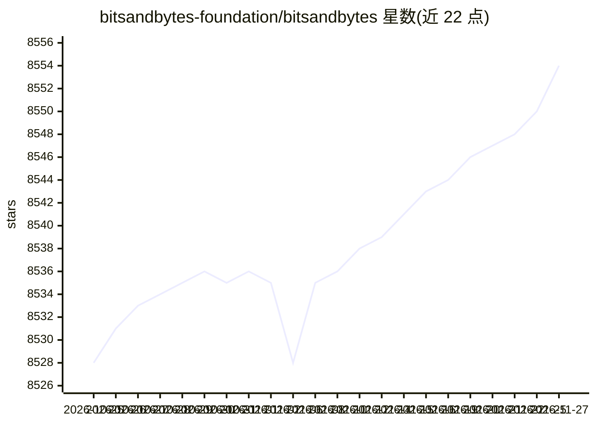

# bitsandbytes-foundation/bitsandbytes

⭐ 8,554 · Python · MIT · 推送 2026-11-25 · [GitHub](https://github.com/bitsandbytes-foundation/bitsandbytes) · [官网](https://huggingface.co/docs/bitsandbytes/main/en/index) · 组织维护

**PyTorch k-bit 量化库：降低 LLM 推理与训练显存占用**

bitsandbytes 为 PyTorch 提供 k-bit 量化能力，包含三类功能：8-bit 优化器（分块量化）、LLM.int8() 8-bit 量化（推理显存减半）、QLoRA 4-bit 量化（配合低秩适配权重用于训练）。库内提供 Linear8bitLt、Linear4bit 量化原语与 optim 优化器模块。要求 Python 3.10+ 与 PyTorch 2.4+，支持 Linux/Windows/macOS 下的 NVIDIA、AMD、Intel GPU 及 CPU 后端，各自标注了各项功能的支持状态。MIT 许可，README 给出三篇可引用论文的 BibTeX。

## 筛选速览

| 维度 | 判定 | 备注 |
|---|---|---|
| AI 角色 | `ai-ecosystem` | LLM/agent 周边工具 |
| 许可风险 | `permissive` | MIT |
| 部署形态 | `library` | 以包/库形式分发 |
| 模型依赖 | — | README 未给出锁定关系 |
| 硬件要求 | — | 无带数字的原话,不猜 |
| 安装摩擦 | `medium` | 含编译或系统依赖之一 |
| 成熟度 | — | 结构信号不足 |

## 能力要点

- 8-bit 优化器、LLM.int8() 8-bit 量化、QLoRA 4-bit 量化三类功能
- 提供 Linear8bitLt / Linear4bit 量化原语与 optim 模块
- 多平台多加速器支持矩阵（NVIDIA/AMD/Intel/CPU/Metal），标注各功能支持状态
- README 附 QLoRA、LLM.int8()、8-bit 优化器三篇论文引用条目

## 适用场景

- 显存受限环境下运行大语言模型推理
- 对量化后的模型进行 QLoRA 微调训练
- 为 PyTorch 训练任务替换为 8-bit 优化器以降低显存占用

## 场景标签

`模型量化` `微调` · 领域:训练与推理

## 证据(README 行号)

> L9: `bitsandbytes` enables accessible large language models via k-bit quantization for PyTorch. We provide three main fe
> L15: The library includes quantization primitives for 8-bit & 4-bit operations, through `bitsandbytes.nn.Linear8bitLt` a
> L24: #### Accelerator support:

## 星数曲线

2026-10-25 8,528 → 2026-11-27 8,554（+26）

---
*卡片 v1 · prompt 1.4 · 生成 2026-11-26 · 置信度 high · 依据 README sha `de4cbf48dfe0` · [字段定义](../../DATASET.md)*
