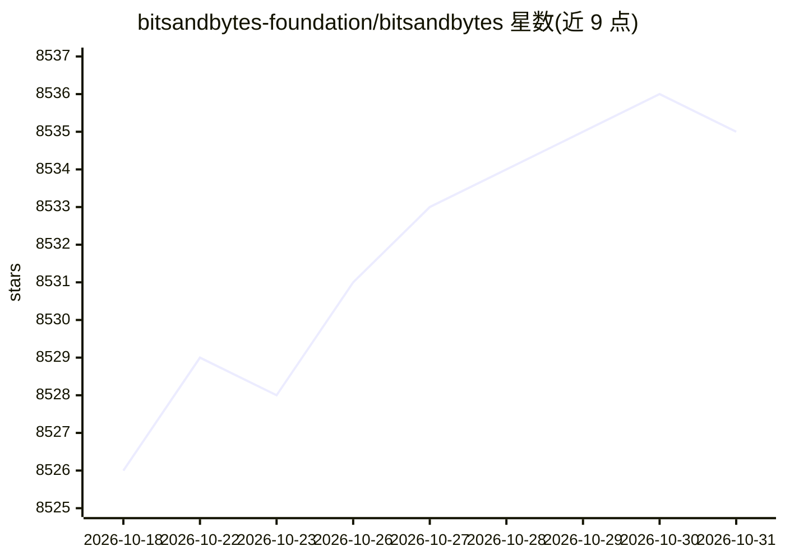

# bitsandbytes-foundation/bitsandbytes

⭐ 8,535 · Python · MIT · 推送 2026-10-27 · [GitHub](https://github.com/bitsandbytes-foundation/bitsandbytes) · [官网](https://huggingface.co/docs/bitsandbytes/main/en/index) · 组织维护

**面向 PyTorch 的 k-bit 量化库，降低 LLM 推理与训练显存占用**

bitsandbytes 是 PyTorch 生态的量化库，提供三项主要能力：8-bit 优化器（块级量化）、LLM.int8() 8-bit 推理量化（离群值单独以 16-bit 矩阵乘处理）、QLoRA 4-bit 量化训练（4-bit 量化模型加低秩可训练权重）。量化原语通过 bitsandbytes.nn.Linear8bitLt / Linear4bit 与 optim 模块暴露。最低要求 Python 3.10+ 与 PyTorch 2.4+，支持 Linux/Windows/macOS 上 NVIDIA、AMD、Intel GPU 及 CPU 等多种加速器；MIT 许可，附 QLoRA 与 LLM.int8() 论文引用。

## 筛选速览

| 维度 | 判定 | 备注 |
|---|---|---|
| AI 角色 | `ai-ecosystem` | LLM/agent 周边工具 |
| 许可风险 | `permissive` | MIT |
| 部署形态 | `library` | 以包/库形式分发 |
| 模型依赖 | — | README 未给出锁定关系 |
| 硬件要求 | — | 无带数字的原话,不猜 |
| 安装摩擦 | `medium` | 含编译或系统依赖之一 |
| 成熟度 | — | 结构信号不足 |

## 能力要点

- 8-bit 优化器、LLM.int8() 推理量化与 QLoRA 4-bit 训练三项能力
- 提供 Linear8bitLt / Linear4bit 量化层与 8-bit 优化器模块
- 跨平台支持 NVIDIA/AMD/Intel GPU 与 CPU（AVX2 起）
- 附 QLoRA（arXiv:2305.14314）与 LLM.int8()（arXiv:2208.07339）论文

## 适用场景

- 在有限显存下加载和推理大语言模型
- 用 QLoRA 低成本微调量化后的模型
- 以 8-bit 优化器减少训练内存占用

## 场景标签

`模型量化` `微调` · 领域:训练与推理

## 证据(README 行号)

> L9: `bitsandbytes` enables accessible large language models via k-bit quantization for PyTorch. We provide three main fe
> L15: The library includes quantization primitives for 8-bit & 4-bit operations, through `bitsandbytes.nn.Linear8bitLt` a
> L21: * PyTorch 2.4+

## 星数曲线

2026-10-18 8,526 → 2026-10-31 8,535（+9）

---
*卡片 v1 · prompt 1.4 · 生成 2026-10-20 · 置信度 high · 依据 README sha `a9b80b73b3d2` · [字段定义](../../DATASET.md)*
