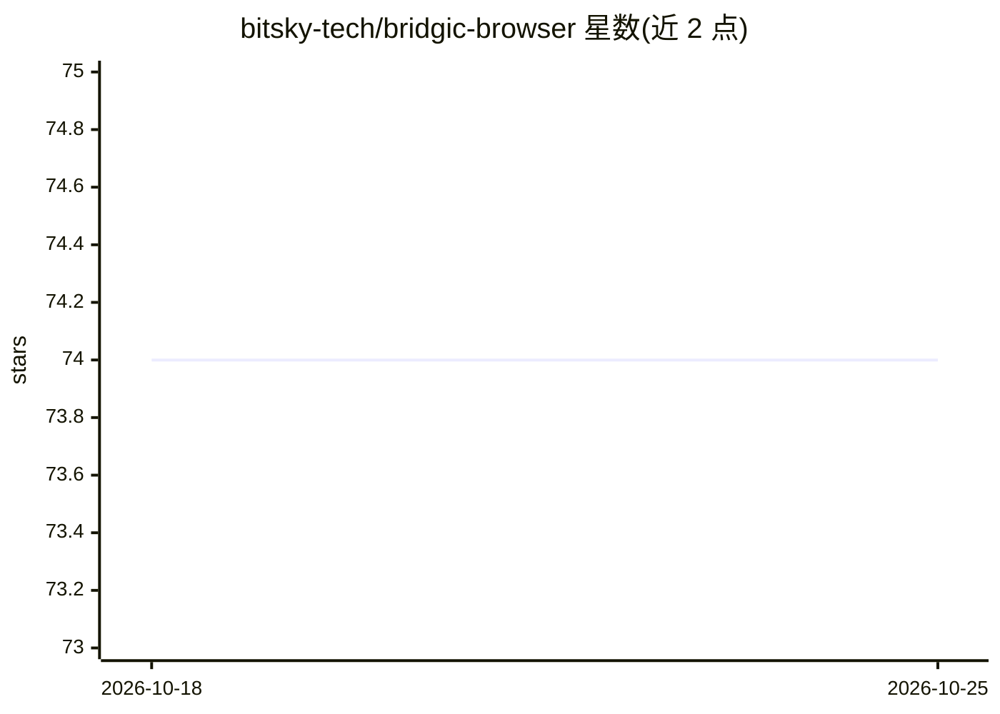

# bitsky-tech/bridgic-browser

⭐ 74 · Python · MIT · 推送 2026-05-19 · [GitHub](https://github.com/bitsky-tech/bridgic-browser) · [官网](https://pypi.org/project/bridgic-browser/) · 组织维护 · 中文 README

**供 AI Agent 调用的 Playwright 浏览器自动化工具库**

基于 Playwright 的 Python 库，把浏览器操作封装为 67 个 CLI 工具（15 类）与 Python 工具集，供 AI Agent 或工作流代码生成调用。核心机制：基于可访问性树的页面快照与跨刷新稳定的元素 ref 生成算法、默认开启的隐身模式（覆盖 24+ JS/CDP 指纹向量）、持久/临时会话、嵌套 iframe 操作。支持通过 Skill/Plugin 接入 Claude Code、Cursor 等编码代理，也提供 CLI 常驻 daemon（Unix domain socket 通信）、CDP 连接已有浏览器与跨实例登录态导出导入。需 pip 安装后另装 Playwright Chromium。

## 筛选速览

| 维度 | 判定 | 备注 |
|---|---|---|
| AI 角色 | `ai-ecosystem` | LLM/agent 周边工具 |
| 许可风险 | `permissive` | MIT |
| 部署形态 | `library` | 以包/库形式分发 |
| 模型依赖 | — | README 未给出锁定关系 |
| 硬件要求 | — | 无带数字的原话,不猜 |
| 安装摩擦 | `low` | 无编译、无系统依赖或容器化 |
| 成熟度 | — | 结构信号不足 |

## 能力要点

- 67 个 CLI 工具（15 类），经 Unix domain socket 连接常驻 daemon
- 基于可访问性树的快照与跨页面刷新稳定的元素 ref 生成算法
- 默认开启的隐身模式，在 JS+CDP 层修补 24+ 检测向量
- 通过 npx skills 安装 Skill 接入编码代理，自动完成安装

## 适用场景

- 让 Claude Code、Cursor 等编码代理直接操作浏览器完成任务
- 让 AI 生成可复用、低 token 消耗的浏览器自动化脚本
- 在 headed 模式完成登录/CAPTCHA 后导出会话态，供 headless 自动化复用

## 场景标签

`浏览器自动化` · 领域:效率与自动化

## 证据(README 行号)

> L5: **Bridgic Browser** is a Python library for LLM-driven browser automation built on Playwright. It includes CLI tools
> L9: - **Comprehensive CLI Tools** - 67 tools organized into 15 categories; Designed to integrate with any AI agent
> L21: The easiest way to use **Bridgic Browser** is with a coding agent or AI assistant (such as Claude Code, Cursor, Cod

## 星数曲线

2026-10-18 74 → 2026-10-25 74（+0）

---
*卡片 v1 · prompt 1.4 · 生成 2026-10-24 · 置信度 high · 依据 README sha `e80152ceb8e7` · [字段定义](../../DATASET.md)*
