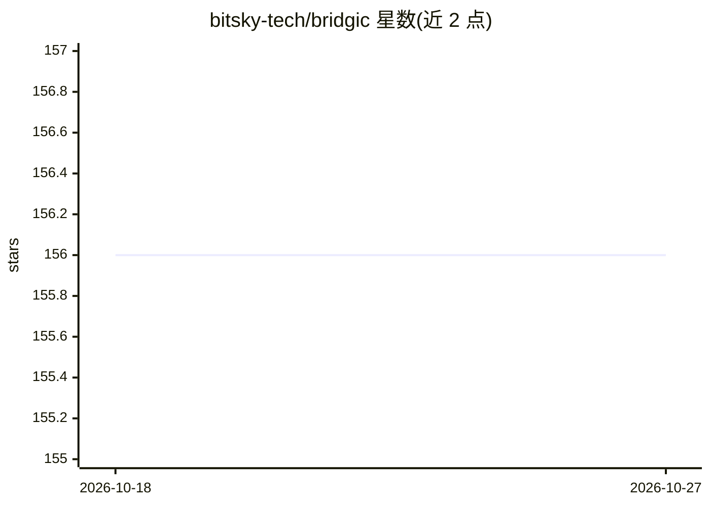

# bitsky-tech/bridgic

⭐ 156 · Python · MIT · 推送 2026-08-04 · [GitHub](https://github.com/bitsky-tech/bridgic) · [官网](https://docs.bridgic.ai/latest/) · 组织维护

**Python agent 开发框架：统一编排确定性工作流与自主 agent**

以动态有向图（DDG）作为统一运行时模型，在同一系统内编排确定性工作流与 LLM 驱动的自主 agent：支持运行时动态拓扑与 ferry_to() 条件路由、声明式 API 与 Python 原生 DSL（ASL）两种写法、参数解析与绑定、基于异步等待与中断恢复的 human-in-the-loop。模型接入通过统一抽象对接任意 LLM 提供方（示例使用 OpenAI），并提供 MCP 集成与 Opik/LangWatch 等观测平台对接。要求 Python 3.9+，pip/uv 安装。

## 筛选速览

| 维度 | 判定 | 备注 |
|---|---|---|
| AI 角色 | `ai-ecosystem` | LLM/agent 周边工具 |
| 许可风险 | `permissive` | MIT |
| 部署形态 | `library` | 以包/库形式分发 |
| 模型依赖 | — | README 未给出锁定关系 |
| 硬件要求 | — | 无带数字的原话,不猜 |
| 安装摩擦 | `low` | 无编译、无系统依赖或容器化 |
| 成熟度 | — | 结构信号不足 |

## 能力要点

- DDG 统一运行时：工作流与 agent 共用一套编排模型
- 运行时动态拓扑修改与 ferry_to() 动态路由
- 声明式 API 与 ASL（Python 原生 DSL）两种开发方式
- 异步等待与中断恢复两种 human-in-the-loop 机制

## 适用场景

- 在同一系统内构建确定性流程与自主决策 agent 的混合应用
- 需要运行时按 LLM 判定结果动态改变执行路径的路由场景
- 长流程中需要人工介入反馈后再恢复执行的 agent 系统
- 通过 MCP 接入外部工具构建多轮交互 CLI 应用

## 场景标签

`Agent 框架` `多智能体` · 领域:Agent 开发

## 证据(README 行号)

> L8: **Bridgic** is the next-generation agent development framework for building intelligent systems.
> L45: * **Unified DDG Foundation**: Both deterministic workflows and autonomous agents are orchestrated through the same 
> L67: * **Technology-neutral Model Integration**: Model integration allows seamlessly integration with any LLM provider t

## 星数曲线

2026-10-18 156 → 2026-10-27 156（+0）

---
*卡片 v1 · prompt 1.4 · 生成 2026-10-22 · 置信度 high · 依据 README sha `c2935a2ff904` · [字段定义](../../DATASET.md)*
