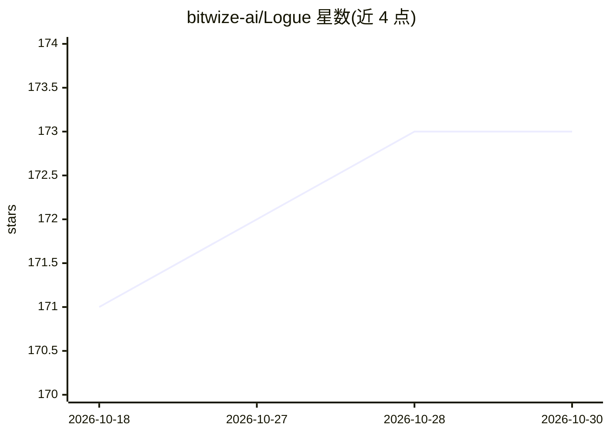

# bitwize-ai/Logue

⭐ 173 · Swift · MIT · 推送 2026-10-07 · [GitHub](https://github.com/bitwize-ai/Logue) · [官网](https://bitwize.ai) · 组织维护

**macOS 本地优先工作区：文档/任务/会议记录+端侧AI转录与代理**

面向 macOS 26+ 的本地优先工作区应用：嵌套空间、块编辑器、类型化属性、自动反向关系、wiki 链接、保存视图与 55 个模板。会议功能包括实时转录（Apple SpeechTranscriber）、说话人分离（Sortformer）、Smart Minutes、行动项提取。代理 Ask Logue 基于 LangGraph-Swift，可访问文档/日历/文件等工具，支持 Chrome 扩展与全局悬浮面板。全部推理通过 Apple Silicon 上的 MLX 端侧运行，仅模型下载等少数网络调用；文档默认 AES-256-GCM 加密，可选纯 .md 存储。由 Bitwize 公司维护，MIT 许可。

## 筛选速览

| 维度 | 判定 | 备注 |
|---|---|---|
| AI 角色 | `ai-enhanced` | 去掉 AI 部分产品仍成立 |
| 许可风险 | `permissive` | MIT |
| 部署形态 | `desktop` | 安装包/桌面程序 |
| 模型依赖 | — | README 未给出锁定关系 |
| 硬件要求 | — | 无带数字的原话,不猜 |
| 安装摩擦 | `medium` | 含编译或系统依赖之一 |
| 成熟度 | — | 结构信号不足 |

## 能力要点

- 转录/分离/摘要/代理全部经 MLX 在 Apple Silicon 端侧运行
- 会议实时转录+说话人分离+Smart Minutes+行动项自动提取
- 多步代理可访问文档/日历/文件，带审批门与来源面板
- AES-256-GCM 磁盘加密，可选纯 markdown 双向同步存储

## 适用场景

- 在 Mac 上本地管理文档、任务与会议纪要，数据不出机器
- 开会时自动转录、分离说话人并生成纪要与待办
- 通过悬浮面板或 Chrome 扩展在任意应用中调用端侧 AI 助手

## 场景标签

`知识库管理` `语音识别` `AI 助手` · 领域:对话与助手

## 证据(README 行号)

> L39: Logue is a workspace. Nested spaces, a block editor, typed properties on any document,
> L50: All of it runs **on-device via MLX on Apple Silicon** — transcription, diarization,
> L148: - **On-device AI by default** — inference, transcription, and diarization run locally via MLX on Apple Silicon; no

## 星数曲线

2026-10-18 171 → 2026-10-30 173（+2）

---
*卡片 v1 · prompt 1.4 · 生成 2026-10-22 · 置信度 high · 依据 README sha `4f0750baacbe` · [字段定义](../../DATASET.md)*
