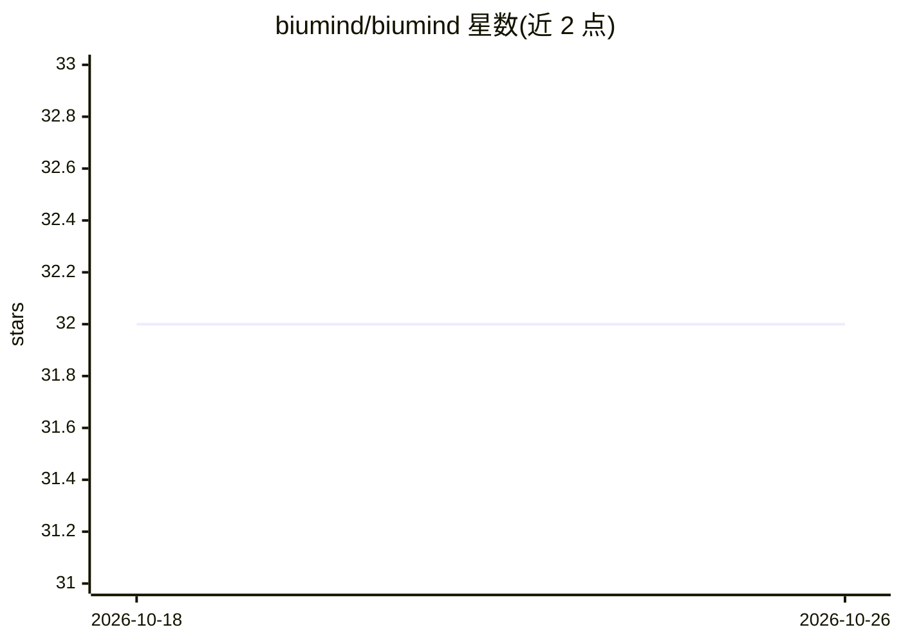

# biumind/biumind

⭐ 32 · Go · NOASSERTION · 推送 2026-10-19 · [GitHub](https://github.com/biumind/biumind) · [官网](https://biumind.xxlab.tech) · 组织维护 · 中文 README

**一体化 AI 工作平台：文档、Agent、编码、笔记统一工作台**

BiuMind 将写文档、跑 Agent、写代码、做笔记收进同一个工作台，对话、剪藏、文档与创作产物沉淀进统一知识库并由 AI 连成知识图谱。六大模块含知识中枢（块编辑器+知识图谱+AI 记忆）、多 AI 工程师并行的编码工作台、文生图/视频创作、消息渠道接入（飞书/Telegram 等）与应用中心。后端为 11 个 Go 微服务（NATS+Postgres/pgvector），模型网关 model-relay 统一出口并支持 BYOK。提供云端注册与 Docker 镜像自托管双轨，桌面/移动/浏览器/CLI 多端，Flutter+Go monorepo。注意：docker-compose 为 dev/test 示例而非生产方案，billing/presence 服务尚在路线图。

## 筛选速览

| 维度 | 判定 | 备注 |
|---|---|---|
| AI 角色 | `ai-native` | 本体是模型或模型工具 |
| 许可风险 | `none` | NOASSERTION |
| 部署形态 | `None` |  |
| 模型依赖 | — | README 未给出锁定关系 |
| 硬件要求 | — | 无带数字的原话,不猜 |
| 安装摩擦 | `low` | 无编译、无系统依赖或容器化 |
| 成熟度 | — | 结构信号不足 |

## 能力要点

- 六大模块：知识中枢、编码工作台、创作、云端工位、消息接入、应用中心
- CLI 与 GUI 共享同一内核、会话互通，四端切换
- model-relay 模型网关统一出口，支持 BYOK 与平台池
- CI 预构建镜像自托管，数据留在自己服务器

## 适用场景

- 在同一个工作台完成写文档、跑 Agent、写代码与笔记，数据互通
- 自托管整套 AI 工作平台，数据留在自己的服务器
- 通过飞书/Telegram 等渠道让 AI 自动回复并召回知识库

## 场景标签

`知识库管理` `知识图谱` `编码 Agent` `图像生成` · 领域:编码与开发

## 证据(README 行号)

> L13: BiuMind 是一个一体化 AI 工作平台：写文档、跑 Agent、写代码、做笔记这些原本分散在多个工具里的工作，被收进同一个工作台，并且**数据互通**——对话、剪藏、文档、创作产物都沉淀进同一个知识库，由 AI 连成知识图谱
> L26: |🧠 **知识中枢**|块编辑器 + 知识图谱 + AI 记忆；文档、对话、网页剪藏沉淀到同一个地方，语义搜索随时找回|
> L27: |💻 **编码工作台**|多个 AI 工程师并行写代码、跑测试、提 PR；改文件 / 跑命令前先征求你的确认；桌面 / 手机 / CLI 切换，任务云端续跑|

## 星数曲线

2026-10-18 32 → 2026-10-26 32（+0）

---
*卡片 v1 · prompt 1.4 · 生成 2026-10-26 · 置信度 high · 依据 README sha `32c766c3b529` · [字段定义](../../DATASET.md)*
