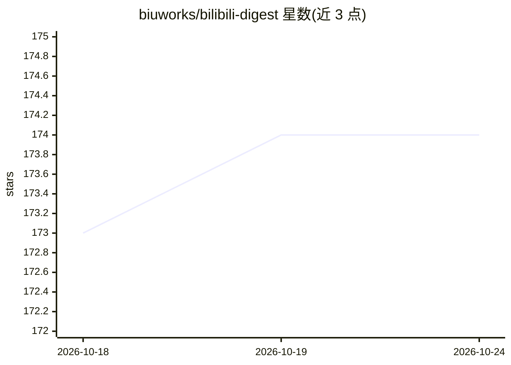

# biuworks/bilibili-digest

⭐ 173 · JavaScript · NOASSERTION · 推送 2026-10-18 · [GitHub](https://github.com/biuworks/bilibili-digest) · 个人维护 · 中文 README

**把 B 站视频变成学习资源的浏览器扩展**

上架 Chrome 与 Edge 商店的浏览器扩展，在 B 站播放页侧边栏提供字幕阅读（原文/译文/双语）、AI 章节概览与金句、划词术语解释、带时间戳的笔记整理与针对当前视频的字幕问答（结论带时间戳引用）。字幕读取自 B 站官方接口；AI 功能需自行配置模型服务地址与密钥，支持本地 Ollama（需设置 OLLAMA_ORIGINS）。字幕阅读开箱即用，非 AI 功能不依赖密钥。源自 youtube-digest（MIT）的复刻项目。

## 筛选速览

| 维度 | 判定 | 备注 |
|---|---|---|
| AI 角色 | `ai-enhanced` | 去掉 AI 部分产品仍成立 |
| 许可风险 | `none` | NOASSERTION |
| 部署形态 | `None` |  |
| 模型依赖 | local-ok | 支持本地模型 |
| 硬件要求 | — | 无带数字的原话,不猜 |
| 安装摩擦 | `low` | 无编译、无系统依赖或容器化 |
| 成熟度 | — | 结构信号不足 |

## 能力要点

- AI 通读字幕生成带时间戳的章节概览与金句，长视频分块并发生成
- 针对当前视频的问答：先检索字幕片段，结论必须带字幕原文时间戳引用
- 带时间戳笔记：AI 整理当前句、可编辑回放、导出 Markdown 学习稿
- 划词解释：结合前后文用大白话说明术语，浮层贴附

## 适用场景

- 看 B 站视频时用双语字幕跟读外文内容
- 用章节概览和金句快速定位长视频重点
- 边看视频边记带时间戳的笔记并整理成学习稿
- 就当前视频内容提问并按时间戳引用回看

## 场景标签

 · 领域:视频学习/浏览器工具

## 证据(README 行号)

> L95: 装好后会打开设置页。字幕阅读开箱即用；顺句、翻译、概览、划词解释、笔记整理和问答需要先填模型服务地址和密钥。
> L3: 把 B 站视频变成学习资源：在播放页旁边打开侧边栏，阅读字幕、对照双语、生成章节概览、划词解释，并记下带时间戳的笔记。

## 星数曲线

2026-10-18 173 → 2026-10-24 174（+1）

---
*卡片 v1 · prompt 1.4 · 生成 2026-10-22 · 置信度 mid · 依据 README sha `7a4e780196ce` · [字段定义](../../DATASET.md)*
