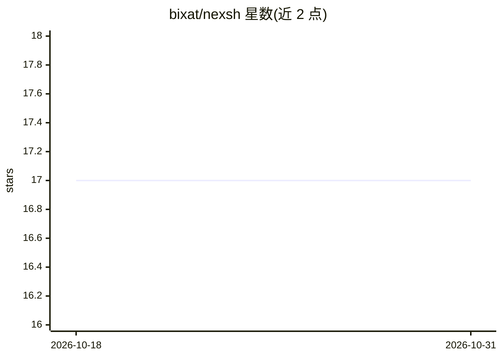

# bixat/nexsh

⭐ 17 · Rust · MIT · 推送 2026-01-24 · [GitHub](https://github.com/bixat/nexsh) · [官网](https://bixat.dev/products/nexsh) · 个人维护

**用 Gemini 把自然语言翻译成 shell 命令的交互式终端**

用 Rust 编写的 AI 驱动 shell：调用 Google Gemini 将自然语言描述翻译为 shell 命令并执行，支持交互式 shell 与单命令（nexsh -e）两种模式。提供彩色输出、可搜索的命令历史、危险命令执行前警告、命令失败时的解释与建议。运行需配置 Gemini API key（默认模型 gemini-2.0-flash），密钥存储于系统配置目录。跨 Linux/macOS/Windows 平台，通过 GitHub Releases 二进制、cargo install 或源码安装。

## 筛选速览

| 维度 | 判定 | 备注 |
|---|---|---|
| AI 角色 | `ai-native` | 本体是模型或模型工具 |
| 许可风险 | `permissive` | MIT |
| 部署形态 | `desktop` | 安装包/桌面程序 |
| 模型依赖 | — | README 未给出锁定关系 |
| 硬件要求 | — | 无带数字的原话,不猜 |
| 安装摩擦 | `low` | 无编译、无系统依赖或容器化 |
| 成熟度 | — | 结构信号不足 |

## 能力要点

- 自然语言转 shell 命令（Gemini 驱动）
- 危险命令执行前警告
- 命令失败时给出解释与可能的解决方案
- 交互式 shell 与单命令两种模式，跨三平台

## 适用场景

- 不记得命令语法时用自然语言描述让终端执行
- 命令报错时快速获得解释与修复建议
- 作为日常交互式 shell 使用并检索历史命令

## 场景标签

`代码生成` · 领域:编码与开发

## 证据(README 行号)

> L14: Next-generation AI-powered shell using Google Gemini
> L26: - 🧠 **AI-powered command interpretation** - Understands natural language commands
> L27: - 🔄 **Smart conversion** - Translates your words into precise shell commands

## 星数曲线

2026-10-18 17 → 2026-10-31 17（+0）

---
*卡片 v1 · prompt 1.4 · 生成 2026-10-29 · 置信度 high · 依据 README sha `c0db937778d9` · [字段定义](../../DATASET.md)*
