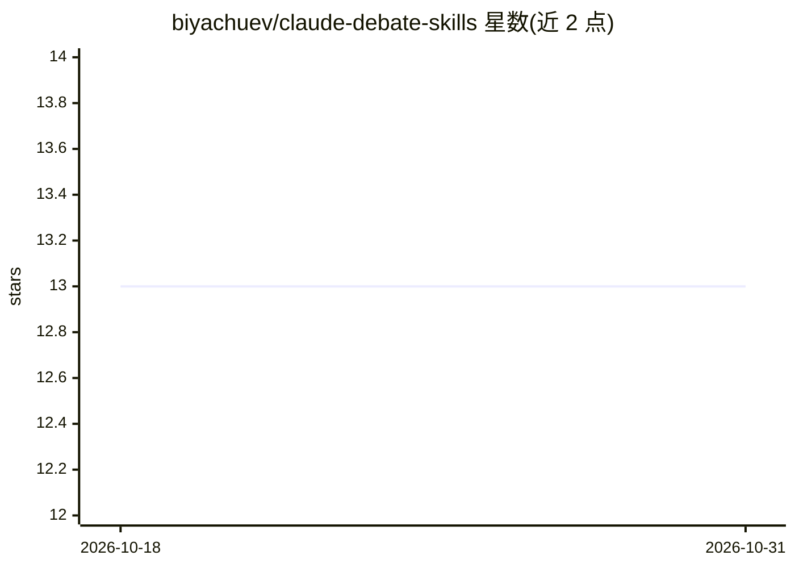

# biyachuev/claude-debate-skills

⭐ 13 · Shell · MIT · 推送 2026-04-17 · [GitHub](https://github.com/biyachuev/claude-debate-skills) · 个人维护 · 中文 README

**让 Claude 与 Codex 结构化辩论的 Claude Code 技能集**

面向 Claude Code 的三个可复用技能（strategy-debate、creator-critic、options-challenge），通过结构化协议让 Claude 与 Codex 两个模型互相辩论、交叉批评并综合结论，用于战略讨论、创意生成与决策压力测试。creator-critic 支持纯 Claude 单模型回退。技能以斜杠命令调用，辩论转录可写入本地 Markdown 文件；限制包括：简报会同时发送给 Anthropic 与 OpenAI、不适用于敏感数据、部分技能强制需要 Codex。

## 筛选速览

| 维度 | 判定 | 备注 |
|---|---|---|
| AI 角色 | `ai-native` | 本体是模型或模型工具 |
| 许可风险 | `permissive` | MIT |
| 部署形态 | `library` | 以包/库形式分发 |
| 模型依赖 | locked-api |  |
| 硬件要求 | — | 无带数字的原话,不猜 |
| 安装摩擦 | `low` | 无编译、无系统依赖或容器化 |
| 成熟度 | — | 结构信号不足 |

## 能力要点

- 三个辩论技能：双声辩论、生成-批评、多路径对比排序
- creator-critic 支持纯 Claude 单模型回退模式
- 辩论日志可保存为本地 Markdown，可用 No Log 关闭
- 提供四种安装方式：插件、脚本、手动符号链接、项目本地

## 适用场景

- 在做出战略或架构决策前让两个模型交叉审视
- 生成并压力测试定价、命名、定位等创意方案
- 对比多条执行路径的取舍并得到排序

## 场景标签

`提示工程` · 领域:Agent 开发

## 证据(README 行号)

> L7: Reusable Claude Code skills for strategy discussions, idea generation, critique, and decision pressure-testing.
> L9: Two AI models, Claude (Anthropic) and Codex (OpenAI), debate each other through structured protocols instead of givi
> L32: |`strategy-debate`|Two-voice debate with cross-critique, revision, and final synthesis|No — two-voice by design|

## 星数曲线

2026-10-18 13 → 2026-10-31 13（+0）

---
*卡片 v1 · prompt 1.4 · 生成 2026-10-31 · 置信度 mid · 依据 README sha `f8ec3da6edaa` · [字段定义](../../DATASET.md)*
