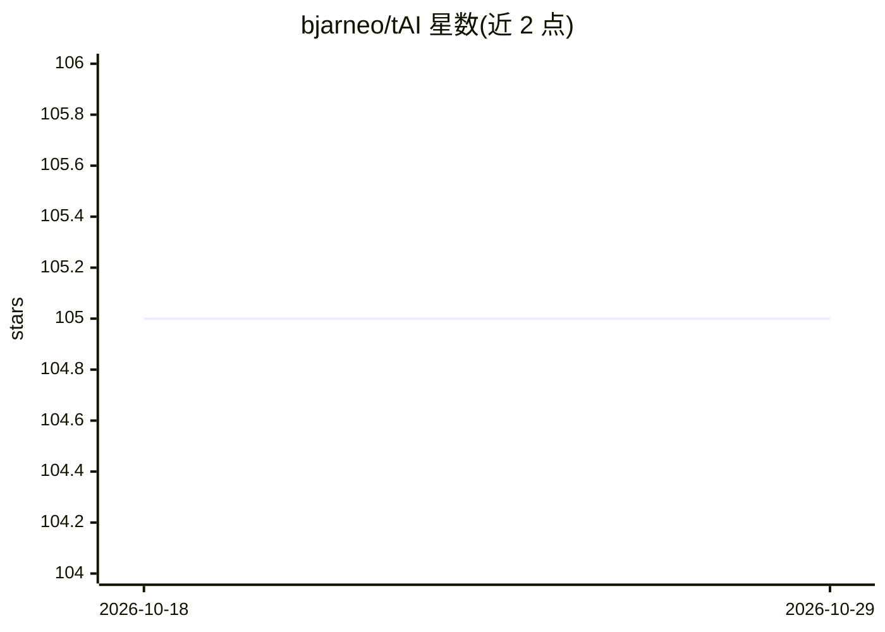

# bjarneo/tAI

⭐ 105 · Python · 推送 2026-02-09 · [GitHub](https://github.com/bjarneo/tAI) · 个人维护

**终端 AI 助手 CLI：给出 Linux/macOS 命令建议并可执行**

面向使用 Linux/macOS 终端的开发者：以自然语言提问，由 AI 生成对应命令并解释其作用，确认后可在终端直接执行。支持 OpenAI、Google、Anthropic、Groq 等多个 AI 供应商，首次运行通过 inquirer 交互式 TUI 选择供应商、模型并保存 API key 到 ~/.config/tai/config.json。以 Python 包形式经 pipx 安装，界面用 rich 渲染。README 提示不要完全信任输出。

## 筛选速览

| 维度 | 判定 | 备注 |
|---|---|---|
| AI 角色 | `ai-native` | 本体是模型或模型工具 |
| 许可风险 | `none` | — |
| 部署形态 | `library` | 以包/库形式分发 |
| 模型依赖 | locked-api |  |
| 硬件要求 | — | 无带数字的原话,不猜 |
| 安装摩擦 | `low` | 无编译、无系统依赖或容器化 |
| 成熟度 | — | 结构信号不足 |

## 能力要点

- 自然语言提问生成终端命令并解释作用
- 支持多个 AI 供应商（OpenAI/Google/Anthropic/Groq）
- inquirer 交互式 TUI 初始配置，配置存于本地 JSON
- 确认建议后可在终端直接执行命令

## 适用场景

- 忘记命令语法时快速获得可执行的命令建议
- 减少查阅 man 手册的时间
- 在终端内直接让 AI 帮忙执行命令

## 场景标签

`AI 助手` · 领域:对话与助手

## 证据(README 行号)

> L3: tAI is a CLI that helps you with Linux and macOS terminal commands. Just ask it a question, and it will use AI to su
> L12: - **NEW:** Support for multiple AI providers (OpenAI, Google, Anthropic, Groq)

## 星数曲线

2026-10-18 105 → 2026-10-29 105（+0）

---
*卡片 v1 · prompt 1.4 · 生成 2026-10-23 · 置信度 high · 依据 README sha `731d170b131c` · [字段定义](../../DATASET.md)*
