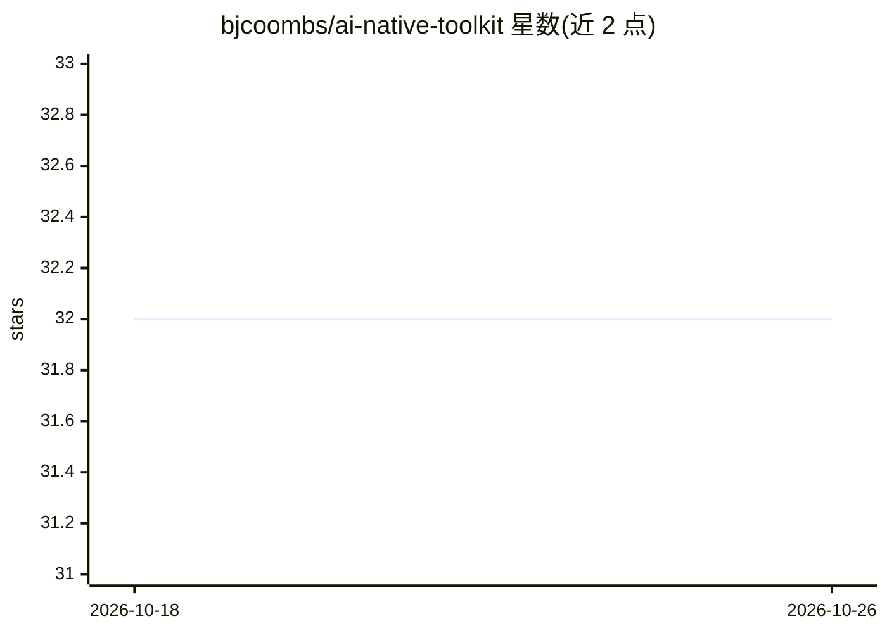

# bjcoombs/ai-native-toolkit

⭐ 32 · Python · Apache-2.0 · 推送 2026-10-16 · [GitHub](https://github.com/bjcoombs/ai-native-toolkit) · 个人维护

**面向 AI 协作开发的 Claude Code 插件与 Agent Skills 工具集**

一个 Claude Code 插件，同时提供可上传到 claude.ai、Claude Desktop 等支持 skills 格式助手的独立技能包。核心含五个技能：/assess 按 0-8 共 9 层契约模型对代码库做 AI 就绪度评分并生成复杂度热点图与文档导航图，/huddle 提供六顶帽结构化多视角审议，/deslop 检测并移除 AI 写作痕迹，/skill-forge 通过评审轮次强化技能，/semantic-compress 压缩 LLM 指令文档。另有 GitHub Action 形式的 CI 评估门，其确定性引擎不消耗 AI token。限制：完整插件需 Claude Code，独立版仅覆盖部分技能。

## 筛选速览

| 维度 | 判定 | 备注 |
|---|---|---|
| AI 角色 | `ai-ecosystem` | LLM/agent 周边工具 |
| 许可风险 | `permissive` | Apache-2.0 |
| 部署形态 | `desktop` | 安装包/桌面程序 |
| 模型依赖 | — | README 未给出锁定关系 |
| 硬件要求 | — | 无带数字的原话,不猜 |
| 安装摩擦 | `low` | 无编译、无系统依赖或容器化 |
| 成熟度 | — | 结构信号不足 |

## 能力要点

- /assess 按 9 层契约模型（0-8）评分并生成复杂度热点 SVG 与文档导航图 SVG
- /deslop 基于 Wikipedia 'Signs of AI writing' 检测 AI 写作痕迹
- 技能以独立 Agent Skills ZIP 发布，不依赖 Claude Code
- GitHub Action 版评估门使用零 AI token 的确定性引擎

## 适用场景

- 评估团队代码库引入 AI agent 贡献者的就绪度
- 在 PR 中以 CI 门禁检查代码库 AI 就绪指标
- 清理 AI 生成内容中的写作痕迹
- 通过六顶帽流程做多视角技术审议

## 场景标签

`提示工程` `AI 写作` · 领域:Agent 开发

## 证据(README 行号)

> L5: A Claude Code plugin - and a set of standalone skills for **any AI assistant**: skills and agents for AI-native deve
> L25: - **`/assess`** - score any codebase's readiness for AI agent contributors against a 9-layer (0-8) contract model (

## 星数曲线

2026-10-18 32 → 2026-10-26 32（+0）

---
*卡片 v1 · prompt 1.4 · 生成 2026-10-26 · 置信度 high · 依据 README sha `b1ec2fe7ec25` · [字段定义](../../DATASET.md)*
