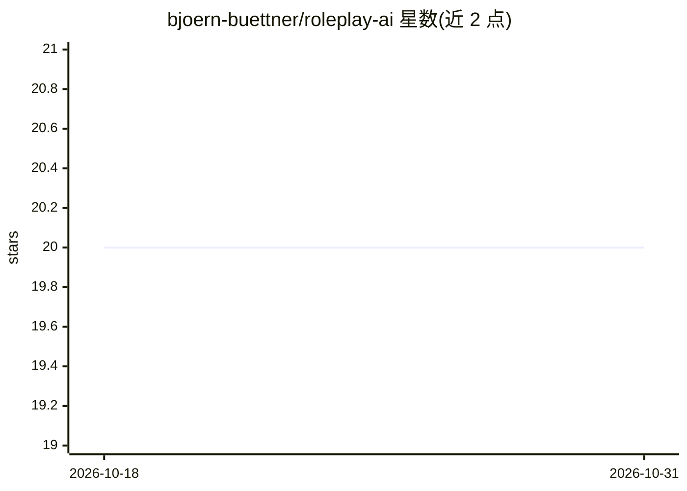

# bjoern-buettner/roleplay-ai

⭐ 20 · Python · MIT · 推送 2026-10-26 · [GitHub](https://github.com/bjoern-buettner/roleplay-ai) · [官网](https://wolfgang-ai.com) · 个人维护

**桌面角色扮演游戏 AI 主持人助手，含自训练模型**

名为 Wolfgang AI 的角色扮演 AI agent 项目：提供游戏主持人风格的对话助手，基于 llama.cpp 或 beam.cloud 运行，使用微调后的 Mistral Instruct v0.3。项目在 Hugging Face 发布三个自训练模型（gamemasterai、characterbuilderai、storysummariserai）及各自训练数据，分别对应游戏主持、角色构建与故事总结能力。可通过 Docker Compose 在本地运行，浏览器中游玩，README 称一台游戏 PC 足以本地运行全部组件。

## 筛选速览

| 维度 | 判定 | 备注 |
|---|---|---|
| AI 角色 | `ai-native` | 本体是模型或模型工具 |
| 许可风险 | `permissive` | MIT |
| 部署形态 | `self-host` | docker 或自建部署 |
| 模型依赖 | — | README 未给出锁定关系 |
| 硬件要求 | — | 无带数字的原话,不猜 |
| 安装摩擦 | `low` | 无编译、无系统依赖或容器化 |
| 成熟度 | — | 结构信号不足 |

## 能力要点

- 游戏主持人风格的角色扮演 AI 助手
- 三个微调模型（主持/角色构建/故事总结）及训练数据发布于 Hugging Face
- 基于 llama.cpp 或 beam.cloud 运行，Mistral Instruct v0.3 微调
- Docker Compose 本地部署，浏览器使用

## 适用场景

- 跑团或角色扮演时让 AI 担任游戏主持人
- 用提供的训练数据改进或扩展模型能力
- 本地部署后通过浏览器进行角色扮演对话

## 场景标签

`聊天机器人` `微调` · 领域:对话与助手

## 证据(README 行号)

> L5: This small repository is meant to create a better AI for role playing by providing a game master style assistant.
> L7: Everything is open source, but the project is also hosted at wolfgang-ai.com and the AI is available at huggingface:

## 星数曲线

2026-10-18 20 → 2026-10-31 20（+0）

---
*卡片 v1 · prompt 1.4 · 生成 2026-10-28 · 置信度 high · 依据 README sha `0e7899e23d87` · [字段定义](../../DATASET.md)*
