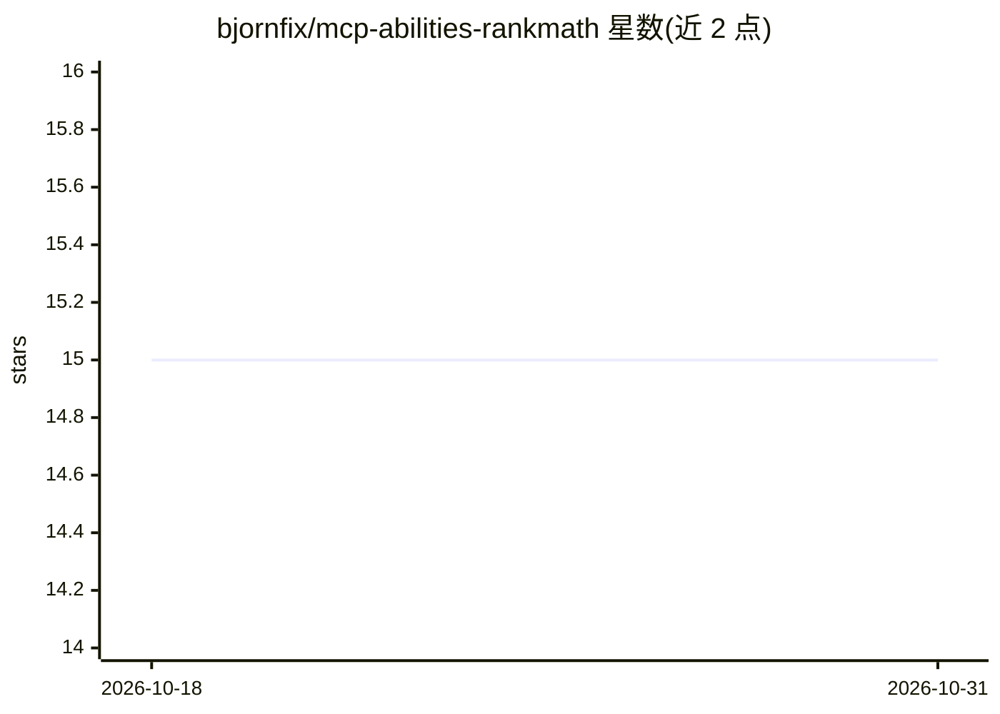

# bjornfix/mcp-abilities-rankmath

⭐ 15 · PHP · 推送 2026-10-25 · [GitHub](https://github.com/bjornfix/mcp-abilities-rankmath) · [官网](https://devenia.com/plugins/mcp-abilities-rankmath/) · 个人维护

**WordPress 插件：让 MCP agent 读写 Rank Math SEO 数据**

面向 WordPress 的 Rank Math SEO 扩展插件，通过 Abilities API 向经过认证的 MCP agent 开放 34 个操作能力，覆盖 SEO 元数据读写、模块开关、schema 记录、站点地图检查、404 日志与重定向管理、发布者资料维护等。工作流为读取-确认-保存-回读，写入操作受 WordPress 权限（edit_posts/manage_options）约束，删除类操作需显式确认。明确声明不提供 AI 模型、关键词研究或流量数据。使用方需 WordPress 6.9+（含原生 Abilities API）、PHP 8.0+、已启用的 Rank Math 模块及 MCP 连接。

## 筛选速览

| 维度 | 判定 | 备注 |
|---|---|---|
| AI 角色 | `ai-ecosystem` | LLM/agent 周边工具 |
| 许可风险 | `none` | — |
| 部署形态 | `None` |  |
| 模型依赖 | — | README 未给出锁定关系 |
| 硬件要求 | — | 无带数字的原话,不猜 |
| 安装摩擦 | `low` | 无编译、无系统依赖或容器化 |
| 成熟度 | — | 结构信号不足 |

## 能力要点

- 34 个 rankmath/* 能力：元数据、选项、模块、schema、重定向、404 日志等
- 审计类操作：批量检查缺失 SEO 字段、低分内容、弱内链、FAQ 块问题
- 权限模型：edit_posts/manage_options 校验，删除与清空操作需显式确认
- 支持 WPML 搜索标题翻译的预览-确认流程与多语言站点地图分页

## 适用场景

- 让 agent 批量修复服务页面的空 SEO 标题与描述
- 站点改版后由 agent 检查 404 日志并创建重定向规则
- 维护发布者资料与社交链接并核对结构化数据
- 审计哪些页面缺内链或未进站点地图

## 场景标签

 · 领域:Web/SEO 自动化

## 证据(README 行号)

> L3: Turn an SEO review into a set of changes you can check in WordPress. MCP Abilities - Rank Math lets an authenticated
> L20: The plugin connects an agent to Rank Math's stored SEO fields, settings, modules, schema records, sitemap output, 4
> L69: - An MCP connection, such as MCP Expose Abilities, configured for the WordPress user carrying out the work.

## 星数曲线

2026-10-18 15 → 2026-10-31 15（+0）

---
*卡片 v1 · prompt 1.4 · 生成 2026-10-30 · 置信度 high · 依据 README sha `1e9547861ff9` · [字段定义](../../DATASET.md)*
