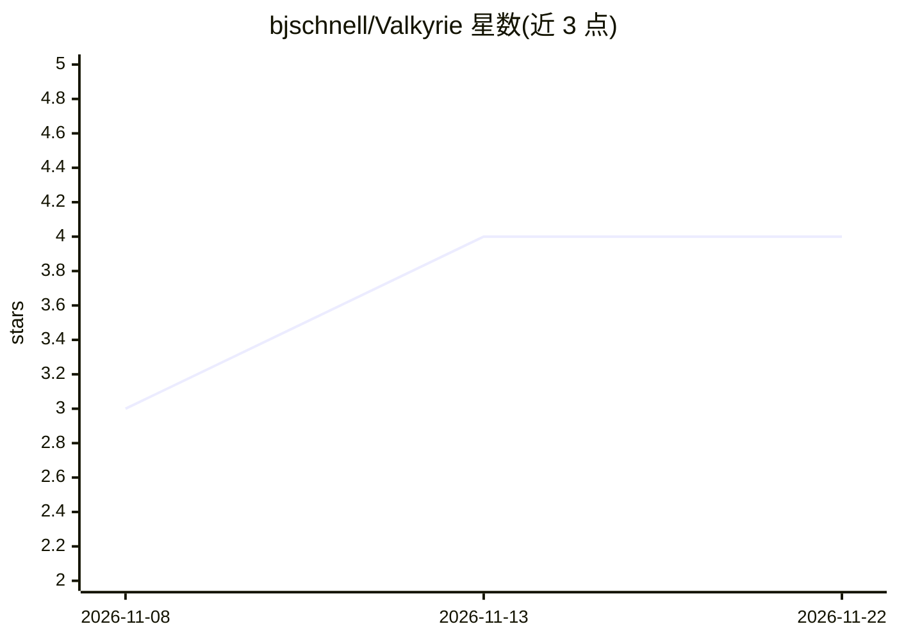

# bjschnell/Valkyrie

⭐ — · [GitHub]() · 个人维护

**给多 agent 开发者用的终端 agent 管理器：统一队列减少打断**

一个用 Rust 编写的 agent 管理器：在终端与手机上并排运行 Claude Code、Codex 及其他 shell 会话，用统一队列显示哪些 agent 在等待用户，支持会话间交接任务、互不冲突的编辑、从纠正中提炼规则、PR 监督与 backlog 启动 agent。产品形态是单个静态二进制，内置 web 手机应用（PWA），通过 QR 码配对；daemon 不监听网络，可用 Tailscale 连接手机。规则起草由用户自己的 Claude 登录调用 Haiku 完成，可关闭。

## 筛选速览

| 维度 | 判定 | 备注 |
|---|---|---|
| AI 角色 | `ai-ecosystem` | LLM/agent 周边工具 |
| 许可风险 | `viral` | — |
| 部署形态 | `None` |  |
| 模型依赖 | — | README 未给出锁定关系 |
| 硬件要求 | — | 无带数字的原话,不猜 |
| 安装摩擦 | `low` | 无编译、无系统依赖或容器化 |
| 成熟度 | — | 结构信号不足 |

## 能力要点

- 统一队列追踪多个 agent 的等待状态，Alt-n 跳转到需要处理的会话
- 从用户纠正中学习项目规则，经批准后同步给其他 agent
- 单个静态 Rust 二进制，自带 web 手机应用与推送通知
- agent 不会未经确认合并或推送 main

## 适用场景

- 同时运行多个编码 agent 时知道哪个在等待自己
- 在手机上回答 agent 的权限请求并查看 diff
- 在 Claude 与 Codex 之间带着上下文交接任务

## 场景标签

`多智能体` · 领域:Agent 开发

## 证据(README 行号)

> L7: An agent manager that learns how you work, so you ship faster and get
> L8: interrupted less. Claude Code, Codex and your shells run side by side, with one
> L91: **Which agents does it work with?**
> L92: Claude Code and Codex get full state tracking and their prompts on your phone.

## 星数曲线

2026-11-08 3 → 2026-11-22 4（+1）

---
*卡片 v1 · prompt 1.4 · 生成 2026-11-21 · 置信度 high · 依据 README sha `4a384b020137` · [字段定义](../../DATASET.md)*
