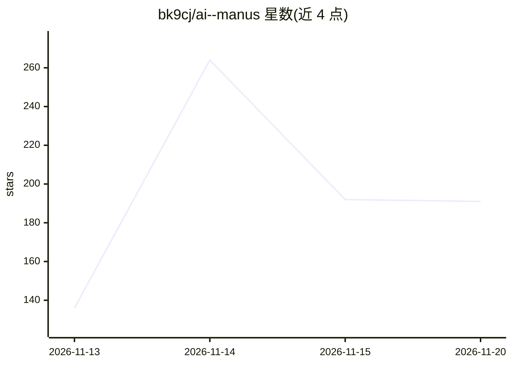

# bk9cj/ai--manus

⭐ 191 · Apache-2.0 · 推送 2026-11-15 · [GitHub](https://github.com/bk9cj/ai--manus) · 个人维护

**自主 AI Agent：代用户执行代码与控制浏览器完成任务**

面向家庭、学习与轻量办公场景的自主 AI Agent，核心能力为代用户编写并执行脚本、控制浏览器（导航网页、填写表单、收集信息）以及多步骤任务处理，代码执行与浏览器操作可在同一流程中衔接。README 描述其为无需编程背景的个人助手，可跨会话复用任务模式。但 README 未给出安装命令、技术架构、模型接入方式或源码运行说明，仅含下载提示、兼容性表与使用步骤，可验证的技术信息有限。

## 筛选速览

| 维度 | 判定 | 备注 |
|---|---|---|
| AI 角色 | `ai-native` | 本体是模型或模型工具 |
| 许可风险 | `permissive` | Apache-2.0 |
| 部署形态 | `None` |  |
| 模型依赖 | — | README 未给出锁定关系 |
| 硬件要求 | — | 无带数字的原话,不猜 |
| 安装摩擦 | `low` | 无编译、无系统依赖或容器化 |
| 成熟度 | — | 结构信号不足 |

## 能力要点

- 自主执行代码与脚本
- 浏览器控制：导航、填表、信息收集
- 代码与浏览器动作在同一工作流中衔接
- 面向小规模场景（家庭/学习/轻办公）

## 适用场景

- 让代理代为完成网页信息收集与表单填写等重复操作
- 学习场景下整理研究资料、运行小脚本
- 多项目并行时把重复步骤交给后台代理处理

## 场景标签

`工作流自动化` `AI 助手` `浏览器自动化` · 领域:效率与自动化

## 证据(README 行号)

> L10: - **Autonomous Code Execution:** Manus AI agent runs code on its own to complete tasks, so you can focus on decisio
> L18: Manus is an autonomous AI agent designed to run code and control a browser on your behalf. Instead of acting like a

## 星数曲线

2026-11-13 136 → 2026-11-20 191（+55）

---
*卡片 v1 · prompt 1.4 · 生成 2026-11-17 · 置信度 low · 依据 README sha `fbfd5e977bf4` · [字段定义](../../DATASET.md)*
