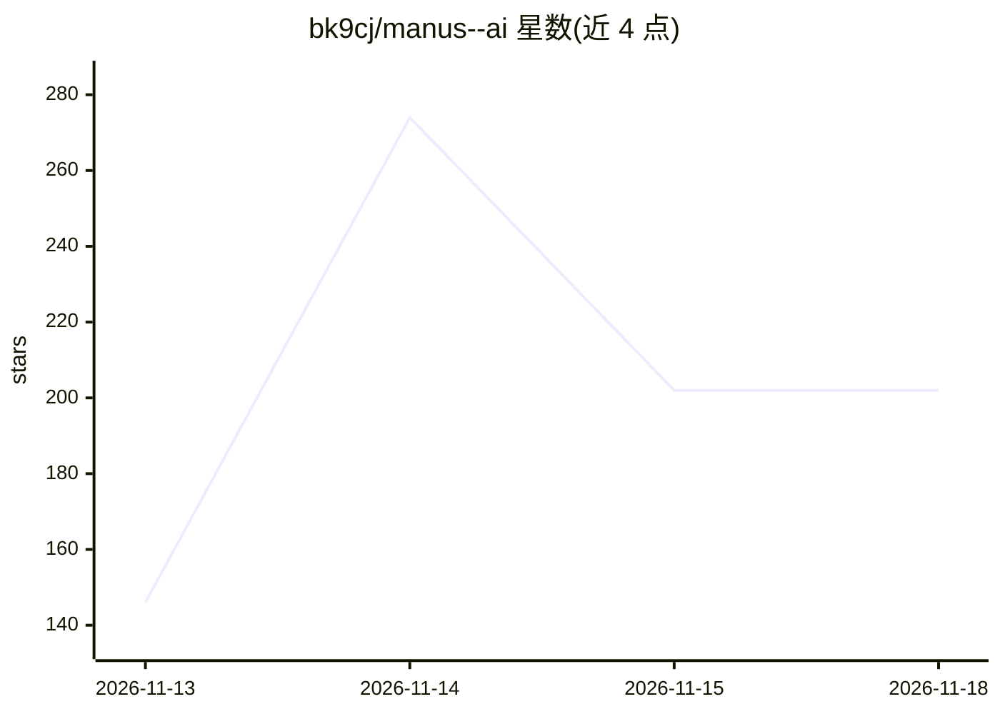

# bk9cj/manus--ai

⭐ 202 · Apache-2.0 · 推送 2026-11-15 · [GitHub](https://github.com/bk9cj/manus--ai) · 个人维护

**面向日常任务的自主 AI Agent：自动执行代码与浏览器操作**

自称 Manus 的自主 AI Agent 产品落地页式 README：代理可自行编写并执行脚本、控制浏览器（导航页面、填写表单、抓取信息），完成多步骤任务，定位为家庭、学习与轻量办公场景的个人后台助手，非企业平台。给出系统兼容性表（最低双核 CPU、4 GB 内存，推荐 8 GB 以上）与上手步骤（准备、配置、测试、细化、应用、维护），但未提供任何安装命令、源码入口或 API 接入说明，且 'Download Manus / PROMO2026' 一节无实际下载链接内容。

## 筛选速览

| 维度 | 判定 | 备注 |
|---|---|---|
| AI 角色 | `ai-native` | 本体是模型或模型工具 |
| 许可风险 | `permissive` | Apache-2.0 |
| 部署形态 | `None` |  |
| 模型依赖 | — | README 未给出锁定关系 |
| 硬件要求 | — | 无带数字的原话,不猜 |
| 安装摩擦 | `low` | 无编译、无系统依赖或容器化 |
| 成熟度 | — | 结构信号不足 |

## 能力要点

- 自主执行代码与浏览器控制（导航、填表、信息采集）
- 脚本与浏览器操作可在同一工作流内衔接
- 任务模式可跨会话复用，支持配置自动/需确认的任务类型

## 适用场景

- 让学生整理研究笔记、跑小型脚本计算
- 让代理代替自己浏览多页面收集信息并做摘要
- 把重复性的日常小任务交给后台代理处理

## 场景标签

`工作流自动化` `浏览器自动化` · 领域:效率与自动化

## 证据(README 行号)

> L10: - **Autonomous Code Execution:** Manus AI agent runs code on its own to complete tasks, so you can focus on decisio
> L18: Manus is an autonomous AI agent designed to run code and control a browser on your behalf. Instead of acting like a

## 星数曲线

2026-11-13 146 → 2026-11-18 202（+56）

---
*卡片 v1 · prompt 1.4 · 生成 2026-11-17 · 置信度 mid · 依据 README sha `fbfd5e977bf4` · [字段定义](../../DATASET.md)*
