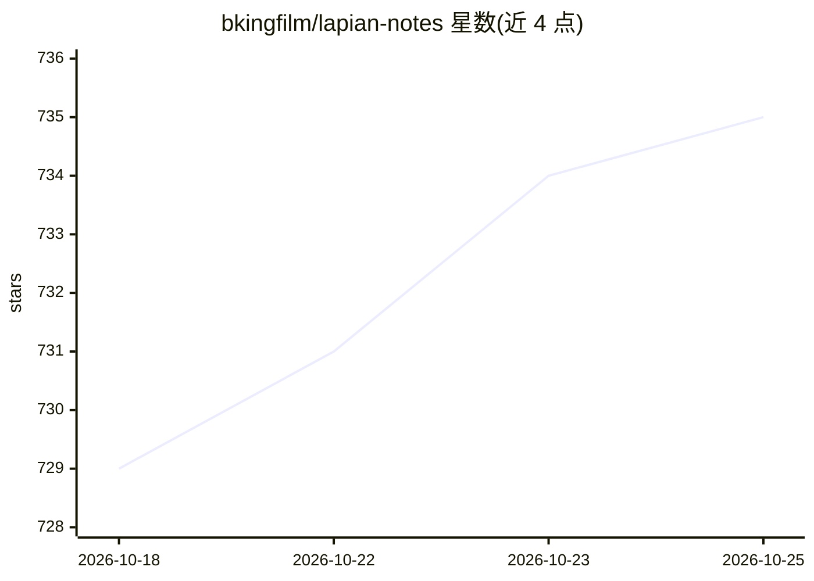

# bkingfilm/lapian-notes

⭐ 736 · TypeScript · MIT · 推送 2026-10-18 · [GitHub](https://github.com/bkingfilm/lapian-notes) · [官网](https://discord.gg/uT6xryBX9w) · 个人维护 · 中文 README

**本地运行的电影拉片工具：AI 辅助生成泳道时间轴与结构树**

面向想系统学习电影叙事的创作者的拉片笔记工具。导入影片后本地按 1 秒抽帧、自动配字幕，把截图与字幕打包成 ZIP 发给 ChatGPT 等任意 AI（不绑定服务、无需 API Key，另可选 AI 直连），导回结果后自动生成剧情泳道时间轴、结构树与观众情绪曲线，支持播放器联动与段落深拆。全程本地运行，数据存于浏览器 localStorage/IndexedDB。提供 zip 下载一键启动（自动装便携 Node），也可 npm run dev 运行；自动转码与搜字幕仅 dev server 完整支持。

## 筛选速览

| 维度 | 判定 | 备注 |
|---|---|---|
| AI 角色 | `ai-native` | 本体是模型或模型工具 |
| 许可风险 | `permissive` | MIT |
| 部署形态 | `library` | 以包/库形式分发 |
| 模型依赖 | locked-api |  |
| 硬件要求 | — | 无带数字的原话,不猜 |
| 安装摩擦 | `low` | 无编译、无系统依赖或容器化 |
| 成熟度 | — | 结构信号不足 |

## 能力要点

- 本地 1 秒间隔抽帧生成带截图的全片时间轴
- AI 分析包机制：不绑定任何 AI 服务，无需 API Key，也可 API 直连（预设 Gemini/Kimi/OpenAI/Claude）
- 剧情泳道时间轴、结构树、观众情绪曲线由 AI 返回结果自动生成
- 笔记时间点一键跳转播放，边播边记

## 适用场景

- 把一部电影整理成可编辑的分镜级拉片笔记
- 分析多线叙事影片的剧情结构与节奏起伏
- 用自己选的 AI（网页上传或 API 直连）完成结构分析

## 场景标签

`知识库管理` · 领域:知识与检索

## 证据(README 行号)

> L12: 把一部电影变成一份可编辑的拉片笔记：本地抽帧、自动配字幕、一键生成 AI 分析包，把 AI 返回的结果导回来，得到剧情泳道时间轴、结构树和观众情绪曲线。
> L25: - **AI 分析包**：把截图、字幕打包成 ZIP，发给 ChatGPT 等任意 AI 分析（不绑定任何 AI 服务，无需 API Key）

## 星数曲线

2026-10-18 729 → 2026-10-25 735（+6）

---
*卡片 v1 · prompt 1.4 · 生成 2026-10-21 · 置信度 high · 依据 README sha `74b8891f8835` · [字段定义](../../DATASET.md)*
