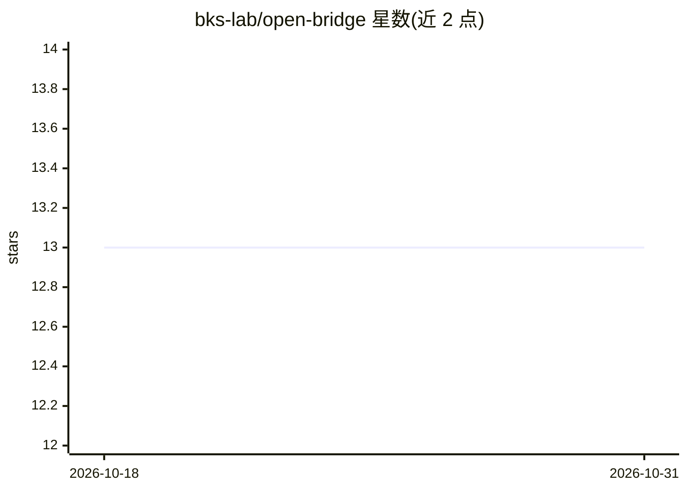

# bks-lab/open-bridge

⭐ 13 · Python · MIT · 推送 2026-10-30 · [GitHub](https://github.com/bks-lab/open-bridge) · [官网](https://bks-lab.github.io/open-bridge/) · 组织维护

**给编码代理用的跨会话记忆与工作区：git 中的 markdown/YAML 上下文**

一个由纯 markdown 与 YAML 文件组成的 git 仓库模板，Claude Code、Codex、Copilot CLI 在每次会话开始时读取这些文件，从而携带用户身份、客户、仓库、任务与工作日志的上下文，避免每次会话重新解释。核心机制包括：ecosystem.yaml 注册表、每任务一个 STATUS.md 的任务管理、共享 skills/ 命令树、protocols 常驻规则；数据放在用户私有仓库分支，CORE 更新与用户数据走不相交路径。限制：无数据库、无托管服务，明确不适用于单仓库单人场景（CLAUDE.md 即可），且未发布实测收益数据；安全门是代理遵循的约定而非 OS 沙箱。

## 筛选速览

| 维度 | 判定 | 备注 |
|---|---|---|
| AI 角色 | `ai-ecosystem` | LLM/agent 周边工具 |
| 许可风险 | `permissive` | MIT |
| 部署形态 | `library` | 以包/库形式分发 |
| 模型依赖 | — | README 未给出锁定关系 |
| 硬件要求 | — | 无带数字的原话,不猜 |
| 安装摩擦 | `low` | 无编译、无系统依赖或容器化 |
| 成熟度 | `idea` | |

## 能力要点

- 一份 skills/ 命令树被 Claude Code、Codex、Copilot CLI 三类工具共同加载
- CORE 更新与用户数据走不相交 git 路径，模板更新不触碰用户数据
- 内置安全门：propose-confirm、按动作逐项确认的外发/破坏性操作门、push guard、秘密仅存引用 URI
- 附带可两命令运行的示例工作区（examples/agency）

## 适用场景

- 多客户/多仓库工作的独立顾问或小团队，让编码代理记住昨天做到哪
- 把会议录音转成纪要、看板任务草案和回顾邮件草稿
- 为组织成员共享统一的配置层（org overlay），新同事开局即带客户与流程上下文

## 场景标签

`Agent 记忆` · 领域:Agent 开发

## 证据(README 行号)

> L5: A git repo of markdown and YAML that Claude Code, Codex or Copilot CLI reads at the start of every session. Your rep
> L69: |**Skills**|one `skills/` tree of plain-language verbs (`/briefing`, `/debrief`, `/archive`, …) that every supporte
> L99: |Same context in Claude Code, Codex, Copilot CLI|partly|yes, for the tools it indexes|per-tool wiring|per-tool wiri

## 星数曲线

2026-10-18 13 → 2026-10-31 13（+0）

---
*卡片 v1 · prompt 1.4 · 生成 2026-10-31 · 置信度 mid · 依据 README sha `291cc2cd446a` · [字段定义](../../DATASET.md)*
