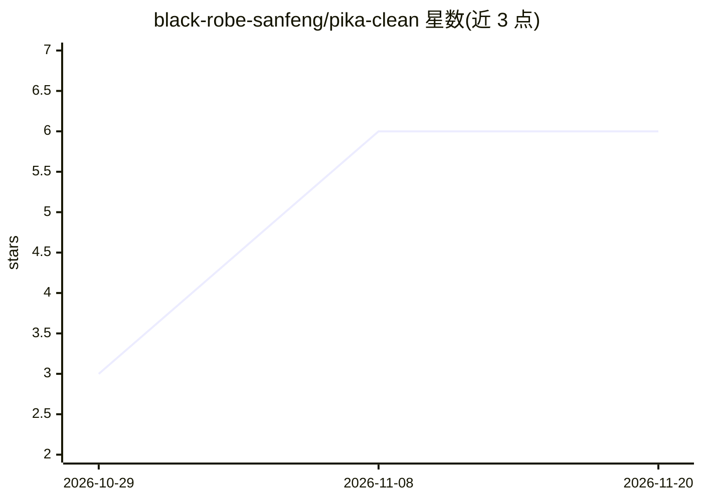

# black-robe-sanfeng/pika-clean

⭐ 6 · Rust · GPL-3.0 · 推送 2026-11-19 · [GitHub](https://github.com/black-robe-sanfeng/pika-clean) · [官网](https://pikaclean.daoly.top) · 个人维护 · 中文 README

**macOS 清理工具：删除前用 AI 解释每个文件能否删**

基于 Tauri（Rust + React）的 Mac 清理应用：扫描缓存、日志、废纸篓、旧下载、安装包、相似照片、崩溃转储与浏览器历史，批量清理；对不确定的文件可点击调用 AI 解释其用途与删除后果，也支持自然语言指令。另含应用卸载器、内存/登录项加速、菜单栏系统监控和磁盘空间图谱。支持 5 种语言，未用 Apple Developer ID 签名，首次启动需在系统设置中手动放行。

## 筛选速览

| 维度 | 判定 | 备注 |
|---|---|---|
| AI 角色 | `ai-enhanced` | 去掉 AI 部分产品仍成立 |
| 许可风险 | `viral` | GPL-3.0 |
| 部署形态 | `desktop` | 安装包/桌面程序 |
| 模型依赖 | local-ok | 支持本地模型 |
| 硬件要求 | — | 无带数字的原话,不猜 |
| 安装摩擦 | `low` | 无编译、无系统依赖或容器化 |
| 成熟度 | — | 结构信号不足 |

## 能力要点

- AI 点击解释文件用途及删除后果，文件内容不上传
- 应用卸载器连偏好设置、缓存与支持文件一并清除
- 菜单栏监控 CPU/GPU/内存/磁盘/网络/电池/温度/风扇
- 开发者清理覆盖 Xcode、模拟器、Docker、包管理器

## 适用场景

- 定期清理 Mac 缓存、日志与废纸篓释放磁盘空间
- 不确定某文件能否删除时让 AI 解释再决定
- 卸载应用后清理残留文件
- 在菜单栏实时查看系统资源占用

## 场景标签

 · 领域:系统工具/macOS 清理

## 证据(README 行号)

> L11: - **Smart scan & clean**: caches, logs, Trash, old downloads, used installers, old screenshots, similar photos, cra
> L12: - **AI explanations**: click anything you're unsure about and AI tells you what it is and what happens if you delet
> L13: - **Uninstaller**: removes apps along with their preferences, caches, and support files. Drag an app to the Trash a

## 星数曲线

2026-10-29 3 → 2026-11-20 6（+3）

---
*卡片 v1 · prompt 1.4 · 生成 2026-11-20 · 置信度 high · 依据 README sha `4987b8a36300` · [字段定义](../../DATASET.md)*
