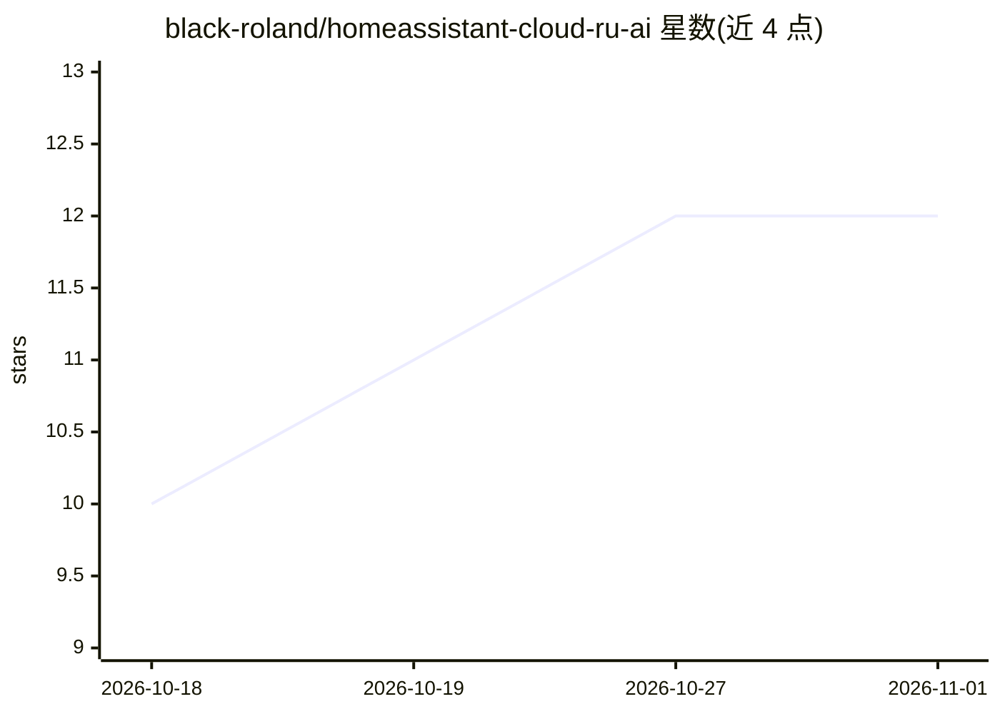

# black-roland/homeassistant-cloud-ru-ai

⭐ 12 · Python · Apache-2.0 · 推送 2026-09-09 · [GitHub](https://github.com/black-roland/homeassistant-cloud-ru-ai) · 个人维护

**将 Cloud.ru 基础模型接入 Home Assistant 的 AI 助手集成**

非官方的 Home Assistant 集成，把 Cloud.ru Foundation Models 云服务接入 Home Assistant，用于创建基于开源 LLM（MiniMax-M2、GLM-4.6、Qwen3-Coder 等）的智能助手。助手可通过对话界面查询设备状态、控制设备（开关灯、调温）并执行脚本，支持在 Home Assistant 内直接切换测试不同模型。安装经 HACS 完成，需注册 Cloud.ru、获取项目 ID 与服务账号 API key；Cloud.ru 为按量计费的云服务，代码基于 Home Assistant 的 OpenAI 集成，以 Apache 2.0 许可发布。

## 筛选速览

| 维度 | 判定 | 备注 |
|---|---|---|
| AI 角色 | `ai-native` | 本体是模型或模型工具 |
| 许可风险 | `permissive` | Apache-2.0 |
| 部署形态 | `None` |  |
| 模型依赖 | — | README 未给出锁定关系 |
| 硬件要求 | — | 无带数字的原话,不猜 |
| 安装摩擦 | `low` | 无编译、无系统依赖或容器化 |
| 成熟度 | — | 结构信号不足 |

## 能力要点

- 接入 MiniMax-M2、GLM-4.6、Qwen3-Coder 等开源 LLM
- 助手可控制设备（开关灯、调温）并执行脚本
- 在 Home Assistant 内直接测试切换不同模型
- 经 HACS 安装，配置项目 ID 与 API key 即可使用

## 适用场景

- 给智能住宅添加可对话、可控制设备的 AI 助手
- 在 Home Assistant 中试用对比多个开源 LLM
- 生成早晨摘要等文本内容

## 场景标签

`AI 助手` · 领域:对话与助手

## 证据(README 行号)

> L7: Интеллектуальный ассистент для вашего умного дома. Интеграция объединяет возможности Cloud.ru Foundation Models с Ho
> L82: - Communicate with the assistant via the Home Assistant UI.

## 星数曲线

2026-10-18 10 → 2026-11-01 12（+2）

---
*卡片 v1 · prompt 1.4 · 生成 2026-11-01 · 置信度 high · 依据 README sha `fa7a67d1863c` · [字段定义](../../DATASET.md)*
