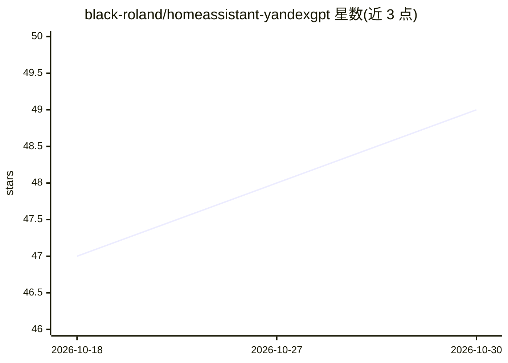

# black-roland/homeassistant-yandexgpt

⭐ 49 · Python · MPL-2.0 · 推送 2026-10-23 · [GitHub](https://github.com/black-roland/homeassistant-yandexgpt) · 个人维护

**将 YandexGPT 接入 Home Assistant 的社区集成**

独立社区开发的 Home Assistant 自定义集成：通过 Yandex Cloud API 调用 YandexGPT 云服务，为智能家居提供自然语言对话助手，可查询与控制设备（开关灯、调温度）、执行脚本与自动化；也可作为 ESPHome DIY 音箱的大脑、用于 Telegram 聊天机器人，并通过 YandexART 生成图像。经 HACS 添加仓库安装，需配置 Yandex Cloud 目录 ID、API key 及服务账户角色。YandexGPT 为付费云服务，按 Yandex Cloud 费率计费，与 Yandex 官方无关联。

## 筛选速览

| 维度 | 判定 | 备注 |
|---|---|---|
| AI 角色 | `ai-enhanced` | 去掉 AI 部分产品仍成立 |
| 许可风险 | `permissive` | MPL-2.0 |
| 部署形态 | `None` |  |
| 模型依赖 | — | README 未给出锁定关系 |
| 硬件要求 | — | 无带数字的原话,不猜 |
| 安装摩擦 | `low` | 无编译、无系统依赖或容器化 |
| 成熟度 | — | 结构信号不足 |

## 能力要点

- 自然语言对话查询并控制 Home Assistant 设备
- 可在自动化中使用（如 Telegram 聊天机器人）
- 经 YandexART 提供图像生成
- 可作为 ESPHome DIY 智能音箱的大脑

## 适用场景

- 在 Home Assistant 中用对话控制灯光、温度等设备
- 让手机或手表上的 HA 应用接入 AI 助手
- 在自动化中调用 YandexGPT 构建聊天机器人或生成图片

## 场景标签

`AI 助手` `聊天机器人` `图像生成` `语音 Agent` · 领域:对话与助手

## 证据(README 行号)

> L7: Ассистент с искусственным интеллектом для вашего умного дома. Интеграция объединяет возможности YandexGPT с Home Ass
> L57: AI-powered assistant for your smart home. This integration bridges YandexGPT capabilities with Home Assistant, enab

## 星数曲线

2026-10-18 47 → 2026-10-30 49（+2）

---
*卡片 v1 · prompt 1.4 · 生成 2026-10-25 · 置信度 high · 依据 README sha `3a3768a27426` · [字段定义](../../DATASET.md)*
