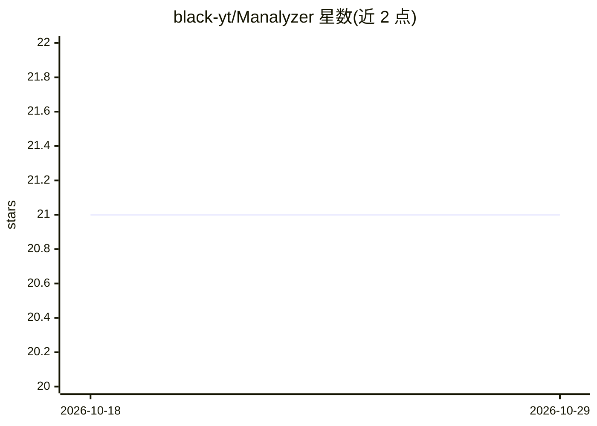

# black-yt/Manalyzer

⭐ 21 · Python · 推送 2026-05-27 · [GitHub](https://github.com/black-yt/Manalyzer) · [官网](https://black-yt.github.io/meta-analysis-page/) · 组织维护 · 中文 README

**多智能体系统：端到端自动化文献荟萃分析并生成报告**

面向科研人员的元分析（meta-analysis）自动化系统：接收用户输入后分三阶段工作——检索并下载论文、筛选有价值的文献；从选定论文中提取数据并整合成表；分析整合数据并输出最终元分析报告。系统采用工具调用与反馈机制的多智能体架构，通过混合审查、层级化抽取、自证与反馈检查策略缓解论文筛选与数据抽取中的幻觉问题。作者构建了含 729 篇论文、3 个领域、超万条数据的评测基准。代码以论文形式发表于 arXiv，提供中英文教程与虚拟环境/pip 的快速开始流程。

## 筛选速览

| 维度 | 判定 | 备注 |
|---|---|---|
| AI 角色 | `ai-native` | 本体是模型或模型工具 |
| 许可风险 | `none` | — |
| 部署形态 | `library` | 以包/库形式分发 |
| 模型依赖 | — | README 未给出锁定关系 |
| 硬件要求 | — | 无带数字的原话,不猜 |
| 安装摩擦 | `low` | 无编译、无系统依赖或容器化 |
| 成熟度 | — | 结构信号不足 |

## 能力要点

- 端到端三阶段流程：文献检索筛选→数据提取整合→元分析报告生成
- 工具调用 + 反馈机制的多智能体架构
- 混合审查、层级化抽取、自证与反馈检查策略缓解幻觉
- 构建含 729 篇论文、3 领域、超 1 万数据点的评测基准

## 适用场景

- 自动化完成文献检索、筛选与数据抽取的元分析流程
- 整合多篇研究数据生成元分析报告
- 科研场景中减少人工文献处理工作量

## 场景标签

`多智能体` `科研工具` · 领域:Agent 开发

## 证据(README 行号)

> L22: Meta-analysis is a systematic research methodology that synthesizes data from multiple existing studies to derive c
> L28: Manalyzer is a multi-agent system incorporating tool calling and feedback mechanisms, enabling end-to-end automated

## 星数曲线

2026-10-18 21 → 2026-10-29 21（+0）

---
*卡片 v1 · prompt 1.4 · 生成 2026-10-28 · 置信度 mid · 依据 README sha `e2effe7d0683` · [字段定义](../../DATASET.md)*
