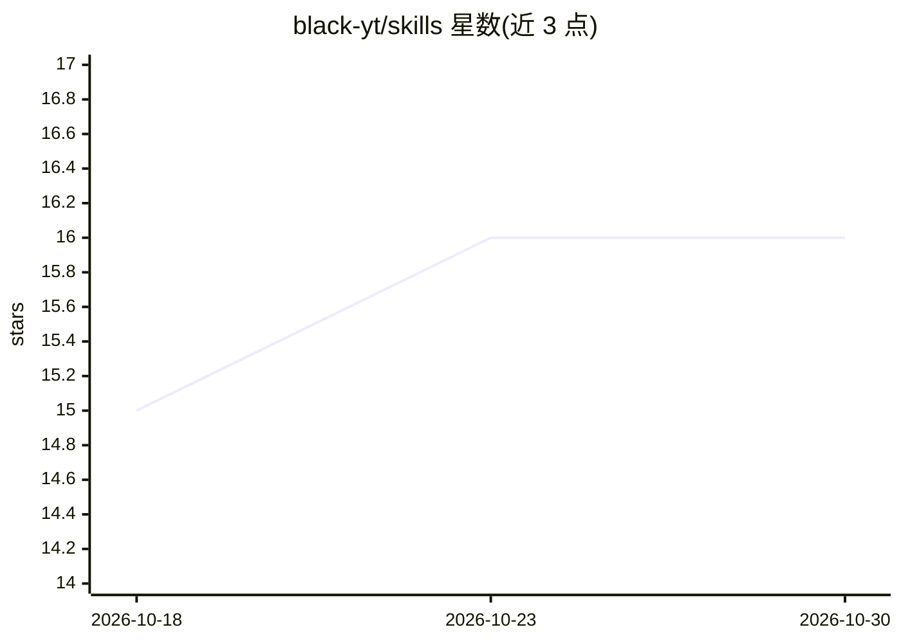

# black-yt/skills

⭐ 16 · Python · 推送 2026-10-27 · [GitHub](https://github.com/black-yt/skills) · [官网](https://black-yt.github.io/skills/) · 个人维护 · 中文 README

**个人维护的可复用 agent skills 集合，覆盖论文写作与文档处理等**

徐望瀚在日常工作中使用和维护的一组按 Anthropic/Claude Skills 风格组织的可复用 agent skills：每个 skill 独立子文件夹并带 SKILL.md，可选 scripts/references/assets 目录。共 30 余个 skill，覆盖 agent 编排、AGENTS.md 维护、AI 会议论文写作、LaTeX 编译与模板迁移、Markdown 转 docx/PDF、PDF 解析、论文图表绘制与审稿、LLM 部署训练、飞书机器人、集群工作流等。提供 download_skill.py 脚本按需下载单个或多个 skill 文件夹。

## 筛选速览

| 维度 | 判定 | 备注 |
|---|---|---|
| AI 角色 | `ai-knowledge` | 知识聚合/清单类 |
| 许可风险 | `none` | — |
| 部署形态 | `None` |  |
| 模型依赖 | — | README 未给出锁定关系 |
| 硬件要求 | — | 无带数字的原话,不猜 |
| 安装摩擦 | `medium` | 含编译或系统依赖之一 |
| 成熟度 | — | 结构信号不足 |

## 能力要点

- 30+ 个 SKILL.md 格式的 agent skills，独立子文件夹组织
- 覆盖论文写作/审稿/rebuttal、LaTeX、Markdown/PDF/docx 文档处理
- 覆盖 LLM 部署训练（vLLM/ms-swift/Megatron）与集群工作流
- download_skill.py 脚本按需下载单个或多个 skill 文件夹

## 适用场景

- 为 Claude/Codex 类 agent 加装论文写作与文档处理技能
- 复用 LaTeX 编译、模板迁移与 Markdown 转换的工作流
- 按需下载部分 skill 到自己的 agent 环境使用

## 场景标签

`提示工程` `科研工具` · 领域:Agent 开发

## 证据(README 行号)

> L3: 这是徐望瀚在日常工作中使用和维护的一组可复用 skills。每个 skill 使用独立子文件夹，并按 Anthropic/Claude Skills 风格提供 `SKILL.md`。
> L17: |Skill|入口文档|用途|

## 星数曲线

2026-10-18 15 → 2026-10-30 16（+1）

---
*卡片 v1 · prompt 1.4 · 生成 2026-10-30 · 置信度 high · 依据 README sha `59432009d3c8` · [字段定义](../../DATASET.md)*
