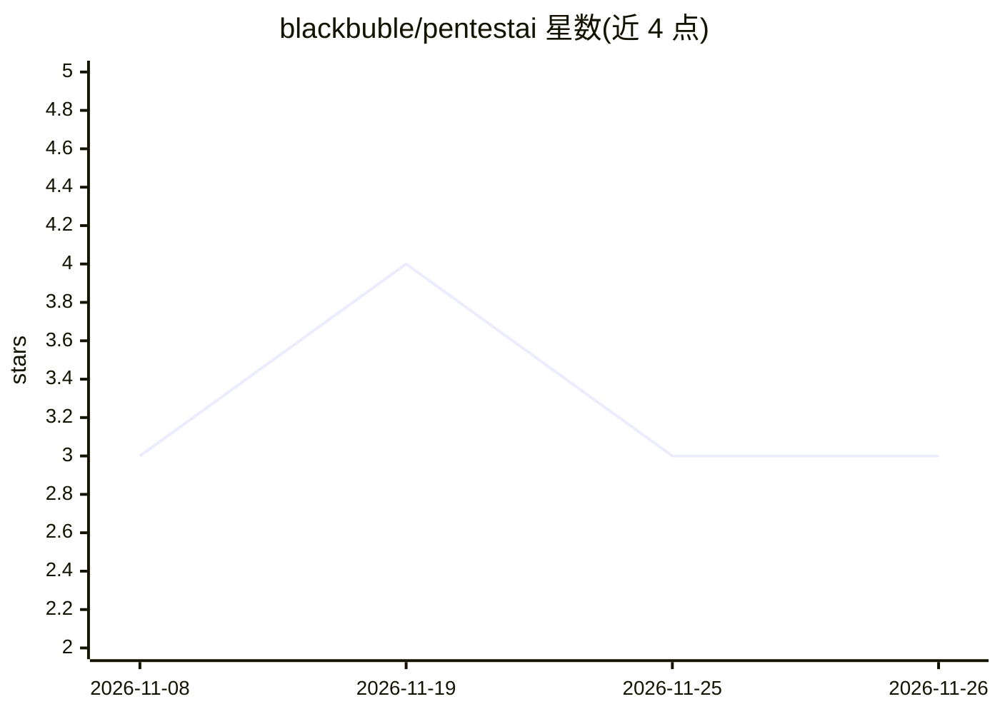

# blackbuble/pentestai

⭐ 3 · Python · MIT · 推送 2026-11-01 · [GitHub](https://github.com/blackbuble/pentestai) · 个人维护

**授权渗透测试的 AI 扫描框架：53+ 工具与 CVE 模板生成报告**

基于 Python 的渗透测试框架，管线为 URL→侦察→AI 计划→扫描→AI 增补→攻击链→报告。两种模式：Scanner-First 确定性管线（19 exploits + 17 scanners，无 LLM，<2s/目标）与 LLM Agent 模式（ReAct 推理，无匹配模式时回退）。含 AutoPilot、ReAct、SelfHeal 三个 agent，LLM 输出仅作增补并标注待审查。安装方式为 git clone + setup.sh、pip 可选 extras、Docker Compose，仅限授权测试使用。

## 筛选速览

| 维度 | 判定 | 备注 |
|---|---|---|
| AI 角色 | `ai-native` | 本体是模型或模型工具 |
| 许可风险 | `permissive` | MIT |
| 部署形态 | `self-host` | docker 或自建部署 |
| 模型依赖 | — | README 未给出锁定关系 |
| 硬件要求 | — | 无带数字的原话,不猜 |
| 安装摩擦 | `low` | 无编译、无系统依赖或容器化 |
| 成熟度 | — | 结构信号不足 |

## 能力要点

- 53+ 内置扫描器覆盖 16 类，9,000+ CVE 模板并集成 Nuclei
- 双模式：确定性 scanner-first 管线与 ReAct 推理循环
- MCP JSON-RPC 接入任意外部工具
- Docker 镜像内置 Metasploit、Neo4j、Qdrant

## 适用场景

- 对已授权目标执行自动化 Web 漏洞扫描并生成 HTML 报告
- 无 API key 环境下运行确定性基准扫描
- 扫描 SPA（Angular/React/Vue）目标时用 Playwright 做表单发现

## 场景标签

`网络安全` · 领域:学习与行业

## 证据(README 行号)

> L2:  AI-powered penetration testing framework
> L53: |**Scanner-First**|Deterministic pipeline. 19 exploits + 17 scanners. No LLM. <2s per target.|
> L64: LLM is **additive only** — scanner findings are never replaced or removed. All AI output labeled `AI-Generated — re

## 星数曲线

2026-11-08 3 → 2026-11-26 3（+0）

---
*卡片 v1 · prompt 1.4 · 生成 2026-11-21 · 置信度 high · 依据 README sha `e851bb20a86a` · [字段定义](../../DATASET.md)*
