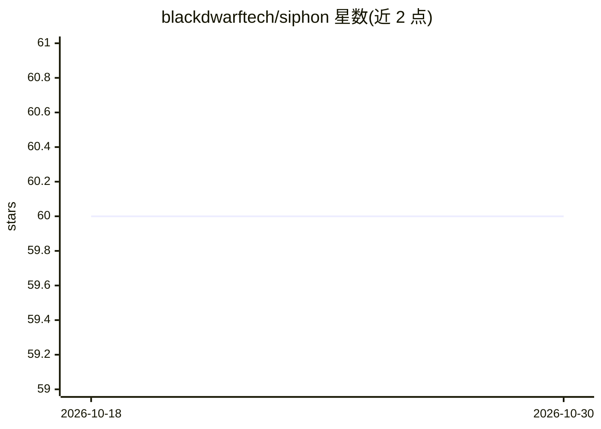

# blackdwarftech/siphon

⭐ 60 · Python · Apache-2.0 · 推送 2026-05-12 · [GitHub](https://github.com/blackdwarftech/siphon) · [官网](https://siphon.blackdwarf.in) · 组织维护

**自托管 AI 电话基础设施：SIP 桥接 LLM 的语音通话框架**

面向企业级语音 AI 的开源基础设施（Apache 2.0），通过 LiveKit/WebRTC 桥接传统 SIP 电话到 LLM，实现亚 500ms 延迟的 AI 呼入/呼出通话。以 Python 框架形式提供（pip 安装 siphon-ai），支持供应商无关配置（OpenAI/Anthropic/Deepgram/Cartesia 及本地模型）、零配置水平扩展、原生入呼路由、程序化外呼、异步工具调用、PostgreSQL/S3 状态记忆与本地 VAD 打断处理。运行需自备 LiveKit（云端或自托管）与模型 API key，数据留在自有 VPC 内。

## 筛选速览

| 维度 | 判定 | 备注 |
|---|---|---|
| AI 角色 | `ai-ecosystem` | LLM/agent 周边工具 |
| 许可风险 | `permissive` | Apache-2.0 |
| 部署形态 | `library` | 以包/库形式分发 |
| 模型依赖 | — | README 未给出锁定关系 |
| 硬件要求 | — | 无带数字的原话,不猜 |
| 安装摩擦 | `low` | 无编译、无系统依赖或容器化 |
| 成熟度 | — | 结构信号不足 |

## 能力要点

- SIP 到 WebRTC 的实时媒体桥接（LiveKit 引擎，宣称亚 500ms 延迟）
- 零配置水平扩展，自动负载均衡活跃语音会话
- 单行配置切换 OpenAI/Anthropic/Deepgram/Cartesia 与本地模型
- 原生入呼路由（按 SIP 头分派不同 AI persona）与程序化外呼编队

## 适用场景

- 自建 AI 前台/客服接听与外呼系统，替代托管 CPaaS 平台
- 在自有 VPC 内运行语音 AI 满足数据合规要求
- 构建带工具调用与跨会话记忆的电话销售/提醒 agent

## 场景标签

`语音 Agent` · 领域:对话与助手

## 证据(README 行号)

> L12: > **Zero platform fees. BYOK. Your VPC. Your data. Your rules.** Siphon is the open-source infrastructure designed 
> L26: - **Provider Agnostic (No Lock-in):** Swap between OpenAI, Anthropic, Deepgram, Cartesia, and local open-source mod

## 星数曲线

2026-10-18 60 → 2026-10-30 60（+0）

---
*卡片 v1 · prompt 1.4 · 生成 2026-10-24 · 置信度 high · 依据 README sha `feb9b67a4f92` · [字段定义](../../DATASET.md)*
