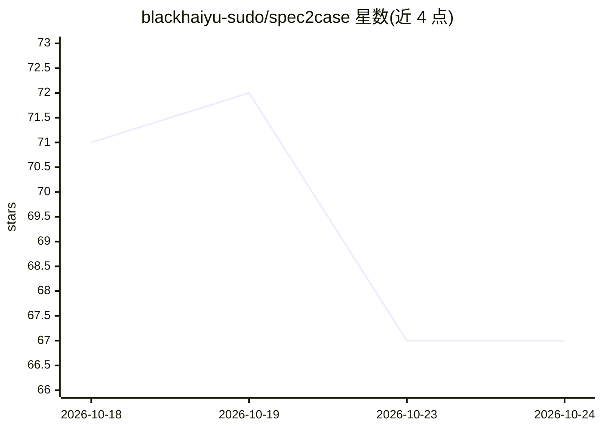

# blackhaiyu-sudo/spec2case

⭐ 67 · Python · MIT · 推送 2026-05-20 · [GitHub](https://github.com/blackhaiyu-sudo/spec2case) · [官网](https://github.com/blackhaiyu-sudo/spec2case) · 个人维护 · 中文 README

**把 PRD/原型图转为结构化测试用例的 AI 平台**

面向 QA、测试开发、产品和研发团队的测试用例生成平台：导入文本需求（PRD/需求说明）或图片需求（原型图、设计稿、截图），系统先审查需求缺口与逻辑不闭环问题，经一次性人工确认补齐事实后，用 LangGraph 编排流程生成普通模块与跨模块链路测试用例，支持页面查看与 Excel/JSON 导出。模型按阶段配置（OpenAI 兼容接口），需在页面“模型配置”中填入需求拆分、用例生成、图片分析三类模型。通过 quick-start 脚本以 Docker 部署，支持 Ubuntu 与 macOS；也提供本地开发方式。项目自述经 80+ 小需求验证、用例可用率 90%+、单任务成本约 1-2 元（自述数据）。

## 筛选速览

| 维度 | 判定 | 备注 |
|---|---|---|
| AI 角色 | `ai-native` | 本体是模型或模型工具 |
| 许可风险 | `permissive` | MIT |
| 部署形态 | `self-host` | docker 或自建部署 |
| 模型依赖 | — | README 未给出锁定关系 |
| 硬件要求 | — | 无带数字的原话,不猜 |
| 安装摩擦 | `low` | 无编译、无系统依赖或容器化 |
| 成熟度 | — | 结构信号不足 |

## 能力要点

- 图片/文本双通道需求导入（PRD、原型图、设计稿、截图）
- 生成前审查需求缺口并经人工确认补齐
- LangGraph 流程编排，OpenAI 兼容模型按阶段配置
- 用例结果支持 Excel/JSON 导出

## 适用场景

- 把 PRD 或原型图快速转成可评审的测试用例
- 在测试设计前发现需求缺口与逻辑不闭环问题
- 团队统一用例风格并批量准备回归测试用例

## 场景标签

 · 领域:软件测试/QA 工具

## 证据(README 行号)

> L3: Spec2Case 是一个面向 QA、测试开发、产品和研发团队的生产级 AI 测试用例生成平台，可以把 PRD、需求文档、产品规格说明、原型图、设计稿、业务截图等输入，转换为结构化、可执行、可导出的测试用例。
> L7: 它也不是简单的“让大模型写用例”：系统会先审查需求缺口和逻辑不闭环问题，再通过人工确认补齐事实，生成用例。
> L22: - 测试用例生成：覆盖普通模块用例和跨模块链路用例。

## 星数曲线

2026-10-18 71 → 2026-10-24 67（-4）

---
*卡片 v1 · prompt 1.4 · 生成 2026-10-24 · 置信度 high · 依据 README sha `0ce1ea487646` · [字段定义](../../DATASET.md)*
