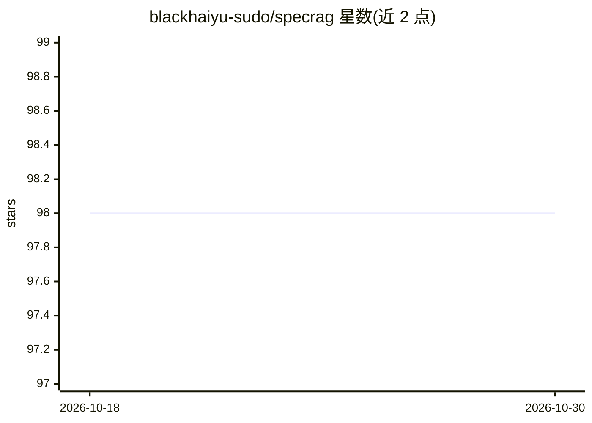

# blackhaiyu-sudo/specrag

⭐ 98 · Python · MIT · 推送 2026-06-18 · [GitHub](https://github.com/blackhaiyu-sudo/specrag) · [官网](https://github.com/blackhaiyu-sudo/specrag#readme) · 个人维护 · 中文 README

**面向业务文档与产品截图的证据型 RAG 知识库**

SpecRAG 是一个将 PRD、业务规则、SOP、流程文档与产品截图转换为可检索知识库的 Web 应用：导入文档或图片后，由 LLM 清洗为结构化知识单元 JSON，生成 query hints 与 key terms，多向量化写入存储，再通过 MCP Agent（pyautogen + OpenAI-compatible API）做证据检索、no-answer 判断与答案整合，并统计耗时与 token。后端 Flask + SQLAlchemy，前端 Vue 2 + Element UI；默认存储为 PostgreSQL + Qdrant（Docker Compose 启动），可选 SQLite 本地小规模验证。需配置文本与视觉两类模型。

## 筛选速览

| 维度 | 判定 | 备注 |
|---|---|---|
| AI 角色 | `ai-native` | 本体是模型或模型工具 |
| 许可风险 | `permissive` | MIT |
| 部署形态 | `self-host` | docker 或自建部署 |
| 模型依赖 | — | README 未给出锁定关系 |
| 硬件要求 | — | 无带数字的原话,不猜 |
| 安装摩擦 | `low` | 无编译、无系统依赖或容器化 |
| 成熟度 | — | 结构信号不足 |

## 能力要点

- 文本文档与多张截图导入并整合为知识库源文档
- LLM 清洗为结构化知识单元，生成 query hints 与 key terms
- MCP Agent 问答：证据检索、no-answer 判断、答案整合
- PostgreSQL + Qdrant 默认企业存储，可选 SQLite 本地模式，附耗时与 token 统计

## 适用场景

- 把 PRD、SOP、业务规则建成可问答的知识库
- 从产品/流程截图中提取需求知识并检索
- 为客服、实施、培训材料搭建证据型问答系统

## 场景标签

`RAG` `文档问答` · 领域:知识与检索

## 证据(README 行号)

> L3: SpecRAG 是一个面向 PRD、业务规则、流程制度、SOP、产品截图和其他业务文档的证据型知识库。
> L5: 它可以把文本业务文档或多张产品/流程截图转换为“知识库源文档”，再清洗为结构化知识单元，生成 query hints，写入向量知识库，并通过 MCP Agent 做证据检索、no-answer 判断和答案整合。

## 星数曲线

2026-10-18 98 → 2026-10-30 98（+0）

---
*卡片 v1 · prompt 1.4 · 生成 2026-10-23 · 置信度 mid · 依据 README sha `22a1b962dd99` · [字段定义](../../DATASET.md)*
