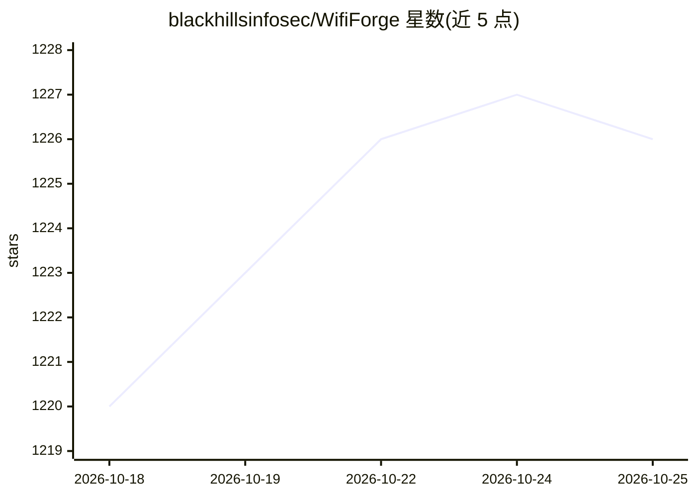

# blackhillsinfosec/WifiForge

⭐ 1,225 · Python · Apache-2.0 · 推送 2026-10-08 · [GitHub](https://github.com/blackhillsinfosec/WifiForge) · 组织维护

**给渗透测试学习者的全虚拟 WiFi 攻击训练沙盒**

Black Hills InfoSec 开发的终端驱动框架，用 mininet-wifi 虚拟接口（mac80211_hwsim）在软件内构建完整虚拟无线网络，无需真实网卡与射频发射，即可练习无线侦察、握手抓取、破解、evil twin、WPS 等攻击。从菜单选择实验后自动搭建网络并进入每节点终端，退出时自动清理。实验以 Python 模块形式编写，声明元数据与 run() 入口即可被自动发现。启动实验需 root 权限，仅限授权环境使用。

## 筛选速览

| 维度 | 判定 | 备注 |
|---|---|---|
| AI 角色 | `ai-enhanced` | 去掉 AI 部分产品仍成立 |
| 许可风险 | `permissive` | Apache-2.0 |
| 部署形态 | `None` |  |
| 模型依赖 | — | README 未给出锁定关系 |
| 硬件要求 | — | 无带数字的原话,不猜 |
| 安装摩擦 | `low` | 无编译、无系统依赖或容器化 |
| 成熟度 | — | 结构信号不足 |

## 能力要点

- mininet-wifi 虚拟接口构建全软件无线网络，无需射频硬件
- 菜单式选择实验，自动完成搭建、tmux 终端分配与清理
- 实验以 Python 模块编写，自动发现，失败实验不拖垮菜单
- wififorge --list 列出全部实验，--allow-non-root 支持无 root 浏览

## 适用场景

- 在无无线网卡的机器上练习 WiFi 攻击技术
- 为渗透测试培训搭建安全合法的沙盒环境
- 自行编写和分享 WiFi 安全实验模块

## 场景标签

`网络安全` · 领域:学习与行业

## 证据(README 行号)

> L23: **WifiForge** is a terminal-driven framework for building **fully virtual** WiFi networks for security research and
> L25: The radios are mininet-wifi virtual interfaces (`mac80211_hwsim`), so an entire airspace, access points, client sta

## 星数曲线

2026-10-18 1,220 → 2026-10-25 1,226（+6）

---
*卡片 v1 · prompt 1.4 · 生成 2026-10-21 · 置信度 low · 依据 README sha `d2b306fc8e25` · [字段定义](../../DATASET.md)*
