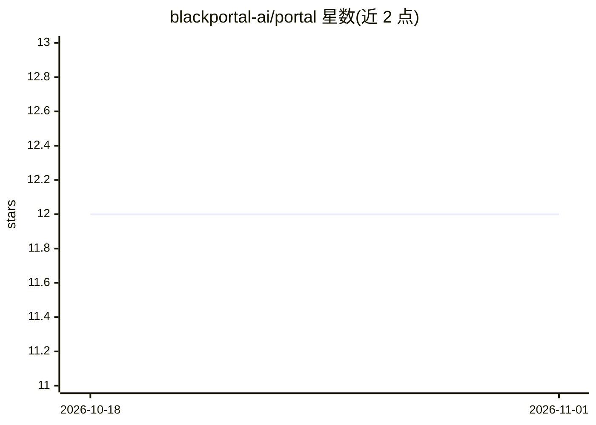

# blackportal-ai/portal

⭐ 12 · TypeScript · MIT · 推送 2026-04-06 · [GitHub](https://github.com/blackportal-ai/portal) · [官网](https://blackportal.ai) · 组织维护

**BlackPortal AI 组织的官方网站代码仓库**

本仓库为 BlackPortal 的官方网站源码，README 仅包含开发说明：通过 npm 安装依赖并本地运行，以及赞助者与 MIT 许可证信息。主题标签含 JavaScript、Node.js、Rust 与 machine-learning，但可见文档未描述任何功能、AI 能力或产品用途。除组织名称含 AI 外，无 README 可验证的 AI 相关内容。

## 筛选速览

| 维度 | 判定 | 备注 |
|---|---|---|
| AI 角色 | `ai-enhanced` | 去掉 AI 部分产品仍成立 |
| 许可风险 | `permissive` | MIT |
| 部署形态 | `library` | 以包/库形式分发 |
| 模型依赖 | — | README 未给出锁定关系 |
| 硬件要求 | — | 无带数字的原话,不猜 |
| 安装摩擦 | `low` | 无编译、无系统依赖或容器化 |
| 成熟度 | — | 结构信号不足 |

## 能力要点

- 提供 npm 安装依赖与本地开发流程说明
- 以 MIT 许可证发布

## 适用场景

- 查看 BlackPortal 官网的实现代码
- 本地运行并修改官网页面

## 场景标签

 · 领域:网站/组织门户

## 证据(README 行号)

> L1: # BlackPortal Website
> L3: The official website for BlackPortal.

## 星数曲线

2026-10-18 12 → 2026-11-01 12（+0）

---
*卡片 v1 · prompt 1.4 · 生成 2026-11-01 · 置信度 low · 依据 README sha `25cfdb4783c1` · [字段定义](../../DATASET.md)*
