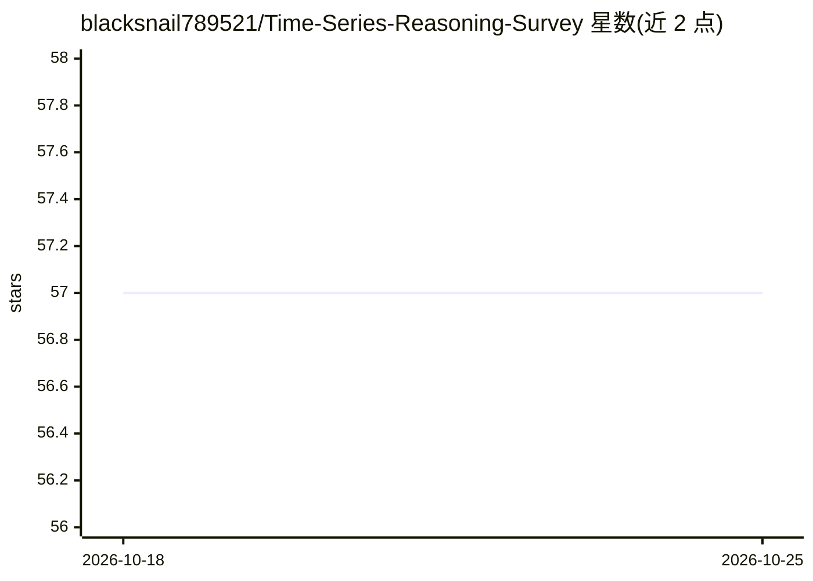

# blacksnail789521/Time-Series-Reasoning-Survey

⭐ 57 · MIT · 推送 2026-06-10 · [GitHub](https://github.com/blacksnail789521/Time-Series-Reasoning-Survey) · [官网](https://arxiv.org/abs/2509.11575) · 个人维护

**时序推理与智能体系统的论文综述清单（TMLR）**

发表于 TMLR 的综述配套仓库：系统整理 LLM 在时间序列推理与智能体方向的研究论文及非研究贡献（数据集、基准、教程、立场文章）。按推理拓扑（直接推理、线性链、分支结构）与主要目标（传统时序分析、解释理解、因果推断、时序生成）两级分类，并用 8 个属性标签（任务分解、验证、工具使用、智能体数量、对齐方式等）标注每篇论文。以 Markdown 表格形式提供分类条目。

## 筛选速览

| 维度 | 判定 | 备注 |
|---|---|---|
| AI 角色 | `ai-knowledge` | 知识聚合/清单类 |
| 许可风险 | `permissive` | MIT |
| 部署形态 | `None` |  |
| 模型依赖 | — | README 未给出锁定关系 |
| 硬件要求 | — | 无带数字的原话,不猜 |
| 安装摩擦 | `low` | 无编译、无系统依赖或容器化 |
| 成熟度 | — | 结构信号不足 |

## 能力要点

- 两级分类体系：推理拓扑 × 主要目标
- 8 个属性标签覆盖控制流、执行者、信息源与对齐方式
- 同时收录研究论文与非研究贡献（数据集/基准/教程）

## 适用场景

- 查找 LLM 时序推理与智能体方向的论文
- 按任务类型（预测、异常检测、时序问答等）检索相关工作
- 了解时序数据集与基准的分类组织

## 场景标签

`精选清单` · 领域:学习与行业

## 证据(README 行号)

> L1: # A Survey of Reasoning and Agentic Systems in Time Series with Large Language Models
> L29: This repository curates and classifies both **research papers** and **non-research contributions** in the field.

## 星数曲线

2026-10-18 57 → 2026-10-25 57（+0）

---
*卡片 v1 · prompt 1.4 · 生成 2026-10-24 · 置信度 high · 依据 README sha `b2a22dbd20e2` · [字段定义](../../DATASET.md)*
