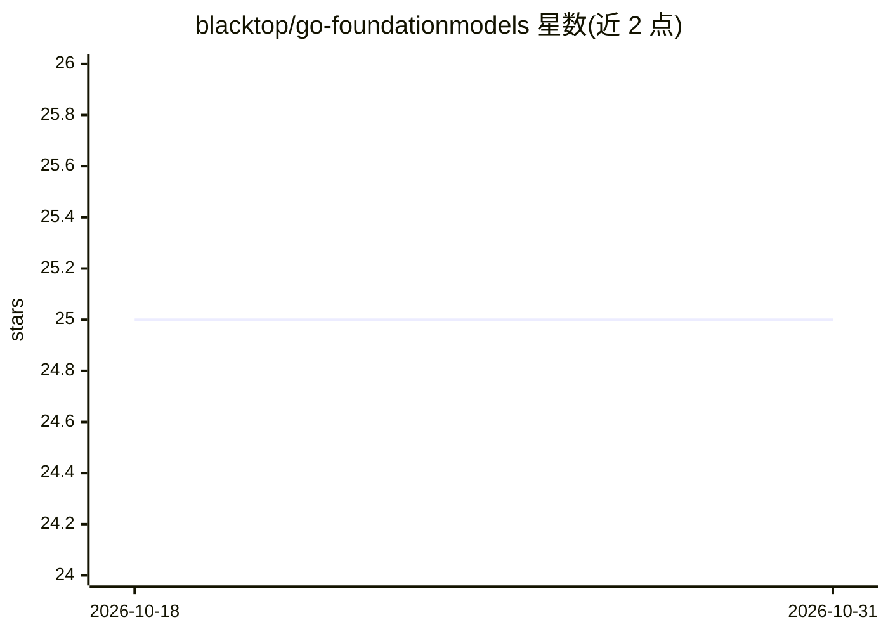

# blacktop/go-foundationmodels

⭐ 25 · Go · MIT · 推送 2026-02-23 · [GitHub](https://github.com/blacktop/go-foundationmodels) · 个人维护

**Apple Foundation Models 的纯 Go 封装库与 CLI**

通过 CGO 将 Swift 桥接代码静态编译进 Go 二进制，使 Go 开发者可调用 macOS 26 Tahoe 的 Apple Foundation Models 端侧模型。提供温度/token 控制、自定义工具调用（含输入校验与 Swift-Go 回调）、4096 token 上下文管理与超时取消；流式输出为模拟实现（后处理分块），原生流式 API 尚未提供。附带 CLI 工具 found（聊天/流式生成/计算/天气工具），可经 Homebrew 或 go install 安装。需 Apple Silicon Mac、Apple Intelligence 与 Xcode 15+。

## 筛选速览

| 维度 | 判定 | 备注 |
|---|---|---|
| AI 角色 | `ai-ecosystem` | LLM/agent 周边工具 |
| 许可风险 | `permissive` | MIT |
| 部署形态 | `library` | 以包/库形式分发 |
| 模型依赖 | — | README 未给出锁定关系 |
| 硬件要求 | — | 无带数字的原话,不猜 |
| 安装摩擦 | `low` | 无编译、无系统依赖或容器化 |
| 成熟度 | `idea` | |

## 能力要点

- Swift 桥静态编译进单一 Go 二进制，无外部依赖
- 自定义工具调用：类型检查、枚举/正则约束、Swift↔Go 回调
- 温度/token 控制、上下文取消、4096 token 窗口管理
- CLI 工具 found：聊天、流式生成、计算与实时天气工具

## 适用场景

- 在 Go 项目中调用 macOS 端侧 Foundation Models 而不写 Swift
- 为端侧模型挂自定义工具获取实时数据
- 用 found 命令行快速测试 Foundation Models 的模型可用性与行为

## 场景标签

`Agent 框架` `聊天机器人` · 领域:Agent 开发

## 证据(README 行号)

> L4:  🚀 Pure Go wrapper for Apple's Foundation Models
> L17: Apple's Foundation Models provides powerful on-device AI capabilities in macOS 26 Tahoe, but it's only accessible t
> L66: go get github.com/blacktop/go-foundationmodels

## 星数曲线

2026-10-18 25 → 2026-10-31 25（+0）

---
*卡片 v1 · prompt 1.4 · 生成 2026-10-27 · 置信度 high · 依据 README sha `88627f65a201` · [字段定义](../../DATASET.md)*
