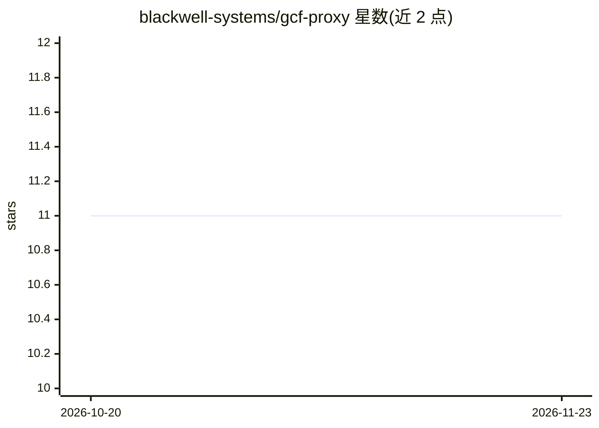

# blackwell-systems/gcf-proxy

⭐ 11 · Go · Apache-2.0 · 推送 2026-09-23 · [GitHub](https://github.com/blackwell-systems/gcf-proxy) · [官网](https://www.gcformat.com) · 个人维护

**MCP 代理：将 JSON 响应转码为 GCF 以减少 token 消耗**

双向 MCP 代理，客户端与服务器均无需改动：以子进程方式启动 MCP 服务器并转发 stdin/stdout，拦截 JSON-RPC 响应将结构化 JSON 重编码为 GCF 格式，并扫描工具调用参数中的 GCF 字符串解码回 JSON。支持 stdio 与 Streamable HTTP 两种传输，提供会话去重、缓存、增量编码、最小体积阈值等开关，向 stderr 记录每次调用的 token 节省。经 pip/npm/go 三渠道分发。

## 筛选速览

| 维度 | 判定 | 备注 |
|---|---|---|
| AI 角色 | `ai-ecosystem` | LLM/agent 周边工具 |
| 许可风险 | `permissive` | Apache-2.0 |
| 部署形态 | `library` | 以包/库形式分发 |
| 模型依赖 | — | README 未给出锁定关系 |
| 硬件要求 | — | 无带数字的原话,不猜 |
| 安装摩擦 | `low` | 无编译、无系统依赖或容器化 |
| 成熟度 | — | 结构信号不足 |

## 能力要点

- 零改动接入：插入任意 MCP 服务器与客户端之间，双向 JSON↔GCF 转码
- 三种分发渠道：pip、npm、go install
- stdio/HTTP 两种模式，可经 --http 部署为带 /health 的远程服务
- 会话去重、响应缓存与增量编码等可选优化开关

## 适用场景

- 无法修改的第三方 MCP 服务器需要降低 token 消耗
- 为现有 MCP 客户端接入 HTTP 远程部署
- 按工具调用统计序列化的 token 节省情况

## 场景标签

 · 领域:LLM 基础设施/MCP 工具链

## 证据(README 行号)

> L7: **Bidirectional MCP proxy that translates between JSON and GCF. Drop-in, zero changes to your server or client. Work
> L115: 1. Spawns your MCP server as a subprocess
> L117: 3. **Responses**: intercepts JSON-RPC responses, re-encodes structured JSON as GCF

## 星数曲线

2026-10-20 11 → 2026-11-23 11（+0）

---
*卡片 v1 · prompt 1.4 · 生成 2026-11-18 · 置信度 high · 依据 README sha `5251e5358f84` · [字段定义](../../DATASET.md)*
