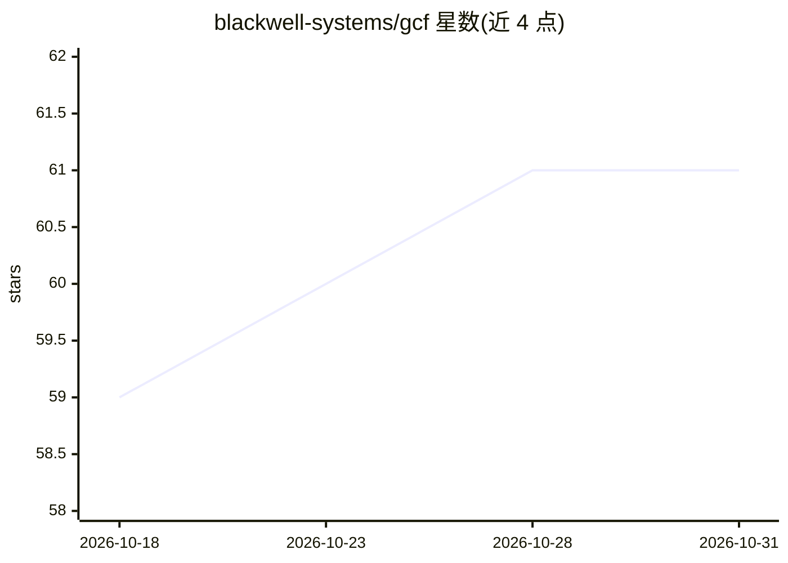

# blackwell-systems/gcf

⭐ 61 · Apache-2.0 · 推送 2026-10-30 · [GitHub](https://github.com/blackwell-systems/gcf) · [官网](http://www.gcformat.com/) · 组织维护

**面向 LLM/Agent 的结构化数据序列化格式，替代 JSON 降 token**

GCF 是一种文本序列化格式，含通用 profile（表格式数组/嵌套对象/标量编码）与图 profile（本地 ID 引用节点与边），可将 JSON/YAML/TOML/CSV/MessagePack 编码为紧凑表示并无损解码还原。面向构建 Agent 与 MCP 工具的开发者，用于降低多轮交互中的 token 消耗，提供会话去重与增量编码。以 7 种语言 SDK（零运行时依赖）、MCP 代理、编辑器插件与 CLI 形式发布，Apache-2.0 许可。规格 v3.6.0，README 声称 43B+ 次往返无损验证。限制：其声称基于作者 2026 年在审论文。

## 筛选速览

| 维度 | 判定 | 备注 |
|---|---|---|
| AI 角色 | `ai-ecosystem` | LLM/agent 周边工具 |
| 许可风险 | `permissive` | Apache-2.0 |
| 部署形态 | `library` | 以包/库形式分发 |
| 模型依赖 | — | README 未给出锁定关系 |
| 硬件要求 | — | 无带数字的原话,不猜 |
| 安装摩擦 | `medium` | 含编译或系统依赖之一 |
| 成熟度 | — | 结构信号不足 |

## 能力要点

- 通用与图两种编码 profile，decode(encode(value))==value 声称无损
- 会话去重与增量（delta）编码，面向多轮 Agent 循环
- 7 种语言 SDK（Go/TS/Python/Rust/Swift/Kotlin/.NET）零运行时依赖
- gcf-proxy 可包装现有 MCP server，另有 Claude Code/Codex/编辑器插件

## 适用场景

- Agent 多轮循环中降低结构化上下文的 token 成本
- MCP 工具输出压缩，替代 JSON 作为 wire format
- 知识图谱/代码结构等节点-边数据的紧凑表示与流式输出

## 场景标签

 · 领域:LLM 数据格式/Agent 基础设施

## 证据(README 行号)

> L10:  The AI-native wire format for structured data. Built for the agentic loop.
> L19: **GCF is built for the agentic loop, where the same structured context crosses the model boundary turn after turn.*
> L35: Or wrap any existing MCP server with zero code changes:

## 星数曲线

2026-10-18 59 → 2026-10-31 61（+2）

---
*卡片 v1 · prompt 1.4 · 生成 2026-10-24 · 置信度 high · 依据 README sha `c92ea7679408` · [字段定义](../../DATASET.md)*
