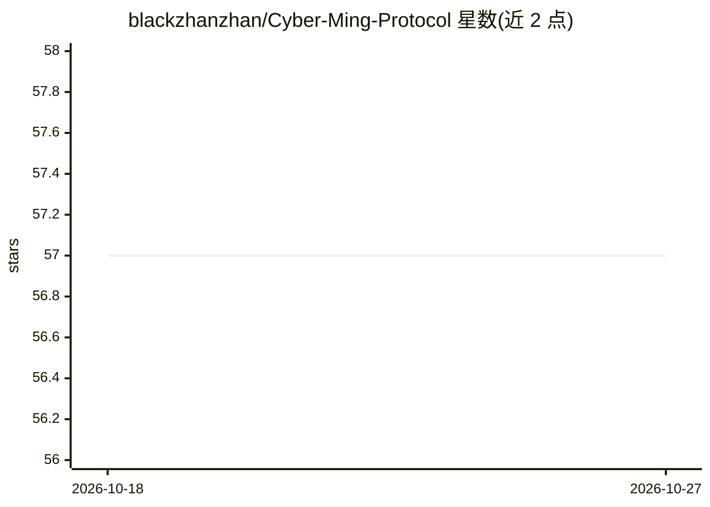

# blackzhanzhan/Cyber-Ming-Protocol

⭐ 57 · JavaScript · MIT · 推送 2026-05-07 · [GitHub](https://github.com/blackzhanzhan/Cyber-Ming-Protocol) · 个人维护 · 中文 README

**面向 AI coding 深水区的人机协作治理协议，附 CLI 安装器**

一套治理 AI coding agent 的方法论加工具：IDE 执行位先提交原子执行合同，Web 审计位独立复核，人类居中裁决与放行；运行时真相通过 skill 外置到 dev_repo/ 的 state.json/journal.jsonl 等文件。提供 npx CLI 安装器，把 skill、starter 与文档装进 Claude Code、Codex、Cursor、OpenCode 四种宿主，支持 project/global 作用域，要求 Node.js >= 18.17.0。另附中英双语静态教学 wiki，由 GitHub Actions 发布到 Pages。面向在深水区项目中试图找回控制权的开发者。

## 筛选速览

| 维度 | 判定 | 备注 |
|---|---|---|
| AI 角色 | `ai-ecosystem` | LLM/agent 周边工具 |
| 许可风险 | `permissive` | MIT |
| 部署形态 | `library` | 以包/库形式分发 |
| 模型依赖 | — | README 未给出锁定关系 |
| 硬件要求 | — | 无带数字的原话,不猜 |
| 安装摩擦 | `low` | 无编译、无系统依赖或容器化 |
| 成熟度 | — | 结构信号不足 |

## 能力要点

- 执行位/审计位/人类裁决三层分离的双轨治理闭环
- CLI 安装器支持 Claude Code、Codex、Cursor、OpenCode 四种宿主
- 运行时真相外置到 dev_repo/（state.json / journal.jsonl / evidence_index.json / tree.md）
- 中英双语静态教学 wiki，GitHub Actions 自动发布

## 适用场景

- 在 AI coding 深水区项目中建立先审方案再开工的治理流程
- 把治理协议接入 Claude Code / Cursor 等常用 AI coding 宿主
- 应对长对话上下文腐烂，用外置真相文件断点续接

## 场景标签

`代码审查` · 领域:编码与开发

## 证据(README 行号)

> L25: 这是一套让 IDE 执行位先交原子执行合同、Web 审计位独立复核、人类居中裁决的深水区 AI coding 协议。
> L33: - 支持宿主：`Claude Code`、`Codex`、`Cursor`、`OpenCode`

## 星数曲线

2026-10-18 57 → 2026-10-27 57（+0）

---
*卡片 v1 · prompt 1.4 · 生成 2026-10-24 · 置信度 high · 依据 README sha `33ce92907611` · [字段定义](../../DATASET.md)*
