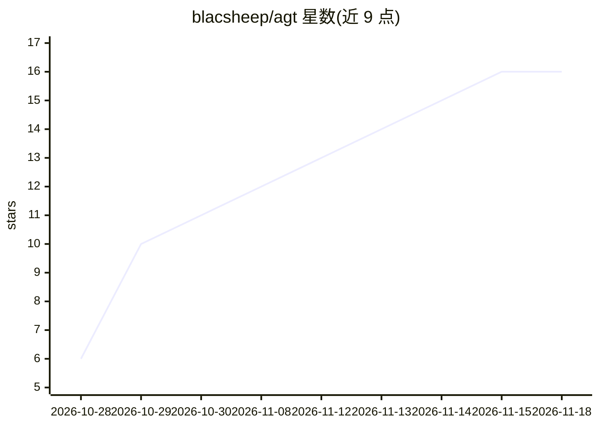

# blacsheep/agt

⭐ 16 · Rust · MIT · 推送 2026-10-27 · [GitHub](https://github.com/blacsheep/agt) · [官网](https://blacsheep.github.io/agt/) · 个人维护 · 中文 README

**本地多智能体编排框架：由主导 agent 自建团队协作**

运行在用户本机的多智能体编排框架：只与一个 lead agent 对话，由它编写角色提示词、创建 agent、让编码 agent 构建缺失的 MCP 工具，并在群聊中调度运行。智能体间通过直接/群聊与 @提及协作，由调度器决定谁发言；隔离由工具强制执行，工具、提示词、模型、MCP 均为可读可编辑的文件。对话、任务与审批存于 SQLite，重启后可续跑。提供命令行工具与桌面应用 AGT Studio，需接入支持工具调用的模型 API（OpenAI 兼容/Anthropic/Gemini）。自述为早期实现、单用户本机使用，非托管服务。

## 筛选速览

| 维度 | 判定 | 备注 |
|---|---|---|
| AI 角色 | `ai-ecosystem` | LLM/agent 周边工具 |
| 许可风险 | `permissive` | MIT |
| 部署形态 | `desktop` | 安装包/桌面程序 |
| 模型依赖 | — | README 未给出锁定关系 |
| 硬件要求 | — | 无带数字的原话,不猜 |
| 安装摩擦 | `low` | 无编译、无系统依赖或容器化 |
| 成熟度 | `idea` | |

## 能力要点

- lead agent 一句话自建团队：写提示词、建 agent、生成 MCP 工具
- 以群聊为编排机制，无需设计工作流图
- 工具级隔离：新 agent 不继承创建者的工具
- Codex/Claude Code/DeepSeek Harness 等编码 agent 可作为团队成员接入

## 适用场景

- 给 lead 一句话，让它自动组建研究/工作团队并执行任务
- 构建需要信息隔离的多智能体游戏（如 AI 狼人杀、推理剧本）
- 本地监控多 agent 协作过程并在关键操作前审批

## 场景标签

`Agent 框架` `多智能体` · 领域:Agent 开发

## 证据(README 行号)

> L14: agt is a multi-agent orchestration framework that runs on your own machine. You talk to one agent, the lead.
> L16: Tell it what you want done, and it writes the role prompts, creates the agents, has a coding agent build any tool t
> L30: **Existing coding agents join the team.** An agent can run on Codex, Claude Code, DeepSeek Harness (`dsh`) or anoth

## 星数曲线

2026-10-28 6 → 2026-11-18 16（+10）

---
*卡片 v1 · prompt 1.4 · 生成 2026-11-18 · 置信度 high · 依据 README sha `699407d0f676` · [字段定义](../../DATASET.md)*
